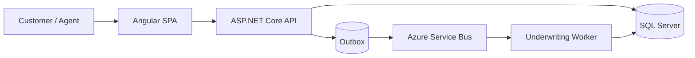
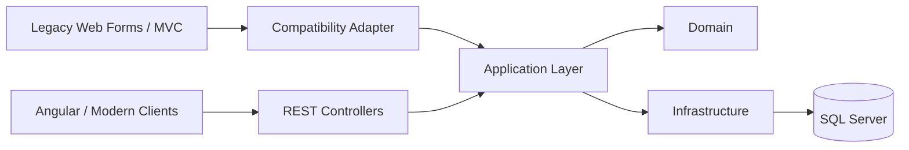
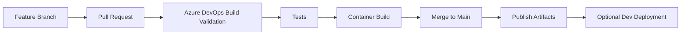

# PolicyFlow POC — Claude Code Build Instructions

## Purpose

Build a small but interview-ready **auto-insurance modernization proof of concept** that demonstrates the technology patterns likely to matter for a senior C#/.NET Software Developer role:

- Modern C# / .NET
- ASP.NET Core REST APIs
- SQL Server
- Angular
- Legacy-to-modern integration
- Asynchronous/event-driven processing
- Azure Service Bus patterns
- Idempotent transaction handling
- Docker-based local development
- Automated unit/integration tests
- Azure DevOps CI/CD
- Observability and production troubleshooting
- Incremental modernization rather than a risky rewrite

The POC is intentionally named **PolicyFlow** and should remain vendor-neutral. Do not use AssuranceAmerica logos, proprietary names, copied site content, or imply that this is an internal AssuranceAmerica system.

---

# 1. Claude Code Operating Instructions

Claude Code must follow these rules throughout the project.

## Execution rules

1. Read this entire file before modifying the repository.
2. Work **one phase at a time**.
3. Do not begin the next phase until the current phase:
   - builds successfully,
   - passes its applicable tests,
   - has no known blocking error,
   - and has been documented in `docs/PROGRESS.md`.
4. Prefer small, reviewable changes over large generated batches.
5. Do not leave placeholder production code such as:
   - `TODO`
   - `NotImplementedException`
   - fake methods returning hard-coded success
   - commented-out broken implementations
6. Test every significant change.
7. Never commit:
   - passwords,
   - connection strings containing secrets,
   - Azure credentials,
   - access tokens,
   - private keys.
8. Use environment variables, `.env.example`, .NET user-secrets, or Azure pipeline secret variables.
9. Keep domain logic outside controllers and Angular components.
10. Keep infrastructure dependencies behind interfaces where practical.
11. Use asynchronous I/O throughout the API/infrastructure layers.
12. Use structured logging.
13. Add XML/API documentation where it materially improves the demo.
14. Favor clarity over excessive abstraction. This is a POC, not a framework.
15. Before declaring a phase complete, run the verification commands documented for that phase and fix failures.

## At the end of every phase

Update `docs/PROGRESS.md` with:

```markdown
## Phase N — <name>

Status: Complete / Blocked

### Completed
- ...

### Verification
- `command`
- Result: PASS / FAIL

### Important decisions
- ...

### Remaining issues
- None
```

Then provide a short terminal summary:

```text
PHASE COMPLETE
Phase:
Build:
Tests:
Containers:
Known issues:
Next phase:
```

---

# 2. Recommended Versions

Use current supported versions unless repository constraints require otherwise.

## Backend

- **.NET 10 LTS**
- C# current language version supported by .NET 10
- ASP.NET Core
- Entity Framework Core
- SQL Server
- `Azure.Messaging.ServiceBus`
- xUnit

Use .NET 10 for a new POC rather than starting new work on .NET 8.

## Frontend

- Current stable Angular CLI compatible with current Node LTS
- TypeScript
- Angular standalone components where appropriate
- Angular HttpClient
- Angular routing
- Reactive forms

Pin generated package versions in `package-lock.json`.

## Local infrastructure

- Docker Desktop / Docker Engine
- Docker Compose
- SQL Server 2022 Linux container
- Microsoft Azure Service Bus emulator container

---

# 3. POC Scenario

The system models a simplified auto-insurance workflow.

## Primary workflow

```text
Customer
   |
   v
Angular UI
   |
   v
POST /api/quotes
   |
   v
PolicyFlow API
   |
   +--> SQL Server: save Pending quote
   |
   +--> Outbox event: QuoteSubmitted
              |
              v
       Service Bus queue
              |
              v
       Underwriting Worker
              |
              +--> simulated prior-insurance verification
              +--> deterministic rating rules
              |
              v
       Update quote:
       Rated / Referral / Declined
              |
              v
GET /api/quotes/{id}
```

A rated quote can then be converted into a policy.

```text
Rated Quote
    |
    v
POST /api/policies/from-quote/{quoteId}
    |
    v
Policy
    |
    v
POST /api/policies/{policyId}/payments
       Header: Idempotency-Key
```

The payment endpoint must prevent accidental duplicate transactions.

---

# 4. What the Finished Demo Must Prove

The final POC must make it easy to explain these interview topics.

## Modern .NET

Demonstrate:

- dependency injection,
- controllers,
- DTO validation,
- async/await,
- clean separation of concerns,
- REST conventions,
- centralized exception handling,
- configuration,
- health checks,
- structured logging.

## SQL Server

Demonstrate:

- relational modeling,
- primary/foreign keys,
- indexes,
- migrations,
- transaction boundaries,
- concurrency awareness,
- idempotency constraints,
- practical query design.

## Legacy modernization

Demonstrate that a legacy system does not need to be rewritten all at once.

Create a compatibility endpoint that represents an older Web Forms/MVC application calling into modern services.

Explain this architectural seam in:

`docs/LEGACY-MODERNIZATION.md`

## Event-driven architecture

Demonstrate:

- asynchronous quote processing,
- Service Bus messaging,
- durable outbox,
- retry-safe consumers,
- dead-letter awareness,
- idempotent message handling,
- correlation IDs.

## DevOps

Demonstrate:

- build,
- automated tests,
- frontend build,
- Docker build,
- artifact packaging,
- pull-request validation,
- protected `main`,
- optional Azure deployment.

---

# 5. Repository Structure

Create this structure unless Claude Code identifies a compelling technical reason to adjust it.

```text
PolicyFlow/
|
|-- PolicyFlow.sln
|-- README.md
|-- POC-INSTRUCTIONS.md
|-- .gitignore
|-- .editorconfig
|-- .env.example
|-- docker-compose.yml
|-- azure-pipelines.yml
|
|-- src/
|   |-- PolicyFlow.Api/
|   |-- PolicyFlow.Application/
|   |-- PolicyFlow.Domain/
|   |-- PolicyFlow.Infrastructure/
|   |-- PolicyFlow.Worker/
|   `-- PolicyFlow.Web/
|
|-- tests/
|   |-- PolicyFlow.Domain.Tests/
|   |-- PolicyFlow.Application.Tests/
|   `-- PolicyFlow.Api.IntegrationTests/
|
|-- infra/
|   |-- servicebus/
|   |   `-- config.json
|   `-- azure/
|       |-- README.md
|       `-- main.bicep
|
`-- docs/
    |-- ARCHITECTURE.md
    |-- API.md
    |-- LEGACY-MODERNIZATION.md
    |-- DEMO-SCRIPT.md
    |-- INTERVIEW-TALKING-POINTS.md
    `-- PROGRESS.md
```

---

# 6. Backend Architecture

Use a lightweight Clean Architecture separation.

## `PolicyFlow.Domain`

Contains:

- entities,
- value objects where useful,
- enums,
- domain rules,
- domain events/contracts that do not depend on infrastructure.

Suggested entities:

### Quote

```text
Id
QuoteNumber
CustomerName
State
VehicleYear
VehicleMake
VehicleModel
AnnualMileage
PriorInsuranceMonths
Status
AnnualPremium
CreatedUtc
UpdatedUtc
RowVersion
```

### Policy

```text
Id
PolicyNumber
QuoteId
EffectiveDate
ExpirationDate
Status
AnnualPremium
CreatedUtc
RowVersion
```

### Payment

```text
Id
PolicyId
Amount
Status
IdempotencyKey
ExternalTransactionId
CreatedUtc
```

### OutboxMessage

```text
Id
EventType
Payload
OccurredUtc
ProcessedUtc
RetryCount
CorrelationId
```

### ProcessedMessage

```text
MessageId
Consumer
ProcessedUtc
```

## Enums

At minimum:

```text
QuoteStatus:
- Pending
- Processing
- Rated
- Referral
- Declined

PolicyStatus:
- Active
- Cancelled
- Expired

PaymentStatus:
- Approved
- Declined
```

---

# 7. Application Layer

Create explicit use cases.

Suggested commands/queries:

```text
SubmitQuoteCommand
GetQuoteQuery
CreatePolicyFromQuoteCommand
GetPolicyQuery
SubmitPaymentCommand
```

Interfaces:

```text
IQuoteRepository
IPolicyRepository
IPaymentRepository
IUnitOfWork
IEventPublisher
IClock
```

Do not allow controllers to directly contain rating logic or EF Core queries.

---

# 8. Quote API Contract

## Submit quote

```http
POST /api/quotes
Content-Type: application/json
X-Correlation-Id: optional
```

Example:

```json
{
  "customerName": "Alex Johnson",
  "state": "GA",
  "vehicleYear": 2024,
  "vehicleMake": "Toyota",
  "vehicleModel": "Camry",
  "annualMileage": 12000,
  "priorInsuranceMonths": 36
}
```

Return:

```http
202 Accepted
Location: /api/quotes/{quoteId}
```

Example response:

```json
{
  "quoteId": "GUID",
  "quoteNumber": "Q-2026-000001",
  "status": "Pending",
  "statusUrl": "/api/quotes/GUID"
}
```

## Get quote

```http
GET /api/quotes/{quoteId}
```

Example rated response:

```json
{
  "quoteId": "GUID",
  "quoteNumber": "Q-2026-000001",
  "status": "Rated",
  "annualPremium": 1482.50,
  "correlationId": "..."
}
```

---

# 9. Deterministic Rating Rules

Do not build a real actuarial rating engine.

Implement intentionally simple, documented rules so test outcomes are deterministic.

Example starting premium:

```text
Base annual premium = 900
```

Add:

```text
Vehicle year >= current year - 2        + 175
Annual mileage > 15000                  + 200
Prior insurance < 6 months              + 300
Prior insurance == 0                    => Referral
State != GA                             + 100
```

Rules must live in a domain/application service such as:

```text
QuoteRatingService
```

Unit test every rule.

Document clearly that the algorithm is fictional and only demonstrates software architecture.

---

# 10. Asynchronous Underwriting

`POST /api/quotes` must **not** synchronously calculate the final premium.

It should:

1. Validate the request.
2. Begin SQL transaction.
3. Insert Quote with `Pending`.
4. Insert `QuoteSubmitted` into Outbox.
5. Commit.
6. Return `202 Accepted`.

Create a background outbox publisher that:

1. retrieves unprocessed outbox records,
2. publishes them to Service Bus,
3. marks them processed only after successful send,
4. retries failures,
5. logs correlation IDs.

## Service Bus queue

Use:

```text
quote-submitted
```

Example event:

```json
{
  "messageId": "GUID",
  "quoteId": "GUID",
  "occurredUtc": "2026-09-10T12:00:00Z",
  "correlationId": "GUID"
}
```

The worker must:

1. receive `QuoteSubmitted`,
2. check `ProcessedMessage`,
3. skip safely if already handled,
4. mark Quote `Processing`,
5. simulate external verification,
6. calculate rating,
7. update Quote,
8. insert `ProcessedMessage`,
9. complete the Service Bus message.

If processing fails:

- abandon/retry according to configured behavior,
- log the failure,
- preserve correlation ID,
- do not silently swallow exceptions.

---

# 11. Simulated External Insurance Verification

Create:

```text
IPriorInsuranceVerifier
```

Implementation:

```text
SimulatedPriorInsuranceVerifier
```

Behavior:

- delay asynchronously for approximately 250–750 ms,
- never block threads using `Thread.Sleep`,
- return deterministic results from input,
- optionally fail for a special test value to demonstrate retry behavior.

Example test trigger:

```text
customerName = "FAIL-DEPENDENCY"
```

This should simulate a temporary dependency failure.

Do not expose this as a production design. Clearly document it as POC behavior.

---

# 12. Policy Creation

Endpoint:

```http
POST /api/policies/from-quote/{quoteId}
```

Requirements:

- quote must exist,
- quote status must be `Rated`,
- prevent creating multiple active policies from the same quote,
- create a unique policy number,
- copy the final annual premium,
- use a transaction,
- return `201 Created`.

---

# 13. Idempotent Payment Endpoint

Endpoint:

```http
POST /api/policies/{policyId}/payments
Idempotency-Key: <GUID or unique client value>
```

Body:

```json
{
  "amount": 125.00
}
```

Requirements:

1. `Idempotency-Key` is required.
2. Create a unique SQL constraint over the appropriate idempotency scope.
3. If the same key is submitted again:
   - do not create another payment,
   - return the original result.
4. Use a SQL transaction.
5. Generate a fake external transaction ID.
6. Log transaction correlation data without logging payment secrets.

This feature should be highlighted in the interview demo.

---

# 14. Legacy Compatibility Seam

Do **not** attempt to run ASP.NET Web Forms in the Linux Docker environment.

Instead create a deliberate modernization seam.

Endpoint:

```http
POST /legacy/quotes
```

Example legacy-style contract:

```json
{
  "InsuredName": "Alex Johnson",
  "RiskState": "GA",
  "VehYear": "2024",
  "VehMake": "Toyota",
  "VehModel": "Camry",
  "Mileage": "12000",
  "PriorCovMonths": "36"
}
```

The legacy controller/adapter should:

1. validate old-format fields,
2. translate strings/legacy naming into the modern application command,
3. invoke the same application layer used by the modern API,
4. translate the modern response into a legacy response.

Do not duplicate business rules.

## `docs/LEGACY-MODERNIZATION.md`

Explain:

```text
Legacy Web Forms / MVC
        |
        v
Compatibility Adapter
        |
        v
Application Services
        |
        v
Modern Domain + Infrastructure
```

Document an incremental migration strategy:

1. inventory legacy behavior,
2. add characterization tests,
3. extract business logic from UI/code-behind,
4. expose reusable services/APIs,
5. move workflows incrementally,
6. retire old pages only after replacement proves stable.

Include a short discussion of:

- Web Forms page lifecycle,
- postbacks,
- ViewState,
- code-behind,
- why business logic should be extracted,
- why a big-bang rewrite is risky.

Optional: add non-compiling reference snippets showing how an older Web Forms page could call the compatibility/API layer, but do not include a Windows-only Web Forms project in the default Docker build.

---

# 15. SQL Server Requirements

Use EF Core migrations.

Create useful indexes for:

```text
Quote.QuoteNumber               UNIQUE
Policy.PolicyNumber             UNIQUE
Policy.QuoteId                  index / uniqueness as required
Payment.IdempotencyKey          UNIQUE within selected scope
OutboxMessage.ProcessedUtc
ProcessedMessage(MessageId, Consumer) UNIQUE
```

Use `rowversion` where appropriate for optimistic concurrency.

Do not use `EnsureCreated()` for normal application startup.

Use migrations.

Initial commands should be similar to:

```bash
dotnet ef migrations add InitialCreate \
  --project src/PolicyFlow.Infrastructure \
  --startup-project src/PolicyFlow.Api

dotnet ef database update \
  --project src/PolicyFlow.Infrastructure \
  --startup-project src/PolicyFlow.Api
```

If migrations are automatically applied in Development, isolate that behavior from Production configuration.

---

# 16. Error Handling

Use ASP.NET Core `ProblemDetails`.

Examples:

```text
400 - invalid request
404 - quote/policy not found
409 - concurrency or duplicate business operation
422 - valid request but invalid business state
500 - unhandled server error
```

Do not return stack traces to clients.

Use a global exception handler.

---

# 17. Correlation IDs

Support:

```http
X-Correlation-Id
```

Behavior:

1. accept a supplied correlation ID when safe,
2. otherwise generate one,
3. return it in the response,
4. include it in structured logs,
5. propagate it into Service Bus messages,
6. use it in worker logs.

This enables an interview demonstration of tracing a transaction across API → database → queue → worker.

---

# 18. Health Checks

Expose:

```http
GET /health/live
GET /health/ready
```

`live`:

- application process is alive.

`ready`:

- SQL Server connectivity,
- Service Bus connectivity or meaningful local equivalent.

Docker Compose should use health checks before dependent containers start.

---

# 19. OpenAPI

Enable OpenAPI for Development.

API documentation should clearly show:

- request models,
- response models,
- response status codes,
- `Idempotency-Key`,
- `X-Correlation-Id`.

Do not expose development OpenAPI automatically in Production unless configured.

---

# 20. Angular Application

Create a simple professional UI.

Routes:

```text
/quotes/new
/quotes/:id
/policies/:id
```

## Quote screen

Fields:

- customer name,
- state,
- vehicle year,
- make,
- model,
- annual mileage,
- prior insurance months.

After submission:

1. show quote number,
2. show Pending/Processing state,
3. poll the quote endpoint every 1–2 seconds,
4. stop polling when final status is reached,
5. display premium if Rated.

## Policy screen

Allow:

- converting a Rated quote to a policy,
- viewing policy number/status,
- submitting a demo payment.

Generate one idempotency key per payment intent and reuse it if the same user action is retried.

## UI priorities

Keep UI intentionally simple.

Do not spend excessive time on design.

The interview value is:

```text
Angular -> REST API -> async processing -> SQL -> Service Bus -> Worker
```

---

# 21. Docker Compose

The local solution should start with:

```bash
docker compose up --build
```

Services:

```text
sql
servicebus-emulator
api
worker
web
```

Use SQL Server:

```text
mcr.microsoft.com/mssql/server:2022-latest
```

Use Microsoft Service Bus emulator:

```text
mcr.microsoft.com/azure-messaging/servicebus-emulator:latest
```

Expose useful local ports approximately as:

```text
Angular:             4200 or 8080
API:                 8081
SQL Server:          1433
Service Bus AMQP:    5672
Service Bus health:  5300
```

Avoid port collisions.

## Service Bus emulator configuration

Create:

`infra/servicebus/config.json`

Configure at least:

```text
Namespace: sbemulatorns
Queue: quote-submitted
```

When application containers share the emulator's Docker bridge network, use the emulator container hostname in the Service Bus development connection string.

Do not commit real Service Bus credentials.

Provide examples through `.env.example`.

---

# 22. Environment Configuration

`.env.example` should contain placeholders only.

Example conceptual values:

```text
MSSQL_SA_PASSWORD=<strong-local-password>
SQL_CONNECTION_STRING=<local-docker-connection>
SERVICEBUS_CONNECTION_STRING=<service-bus-emulator-connection>
SERVICEBUS_QUEUE=quote-submitted
ASPNETCORE_ENVIRONMENT=Development
```

`README.md` must explain how to copy:

```bash
cp .env.example .env
```

and replace local development values.

Add `.env` to `.gitignore`.

---

# 23. Backend Testing

## Domain tests

At minimum test:

- each premium adjustment,
- referral condition,
- valid quote transitions,
- invalid quote transitions.

## Application tests

At minimum test:

- submit quote creates Pending quote,
- policy cannot be created from Pending quote,
- policy can be created from Rated quote,
- duplicate policy creation is rejected,
- duplicate payment idempotency key returns original transaction.

## Integration tests

At minimum test:

```text
POST /api/quotes -> 202
GET /api/quotes/{id}
POST policy from unrated quote -> rejected
payment without Idempotency-Key -> 400
duplicate payment -> one persisted transaction
```

Where practical, integration tests should exercise real SQL Server behavior rather than replacing all persistence with mocks.

---

# 24. Frontend Testing

Test at least:

- quote form validation,
- API service request mapping,
- quote status polling stops at terminal state,
- payment retry reuses idempotency key.

Keep test count modest but meaningful.

---

# 25. Observability

Use structured logging.

Recommended fields:

```text
CorrelationId
QuoteId
QuoteNumber
PolicyId
PolicyNumber
MessageId
Operation
ElapsedMs
Result
```

Never log:

- secrets,
- full credentials,
- authorization tokens.

Add timing around:

- quote submission,
- SQL operations where useful,
- simulated external verification,
- worker processing.

Create `docs/TROUBLESHOOTING.md` if enough troubleshooting material accumulates.

---

# 26. Azure DevOps CI

Create:

`azure-pipelines.yml`

For Azure Repos Git, use a normal CI trigger and configure PR validation through an Azure Repos **branch policy**, not through a YAML `pr:` trigger.

Suggested CI trigger:

```yaml
trigger:
  branches:
    include:
      - main
      - feature/*
```

Pipeline stages/jobs should perform:

## Backend

```text
Use .NET 10 SDK
dotnet restore
dotnet build --configuration Release
dotnet test --configuration Release
```

## Frontend

```text
install current Node LTS
npm ci
npm run lint
npm run test:ci
npm run build
```

## Container validation

```text
docker compose config
docker compose build
```

## Artifact stage

Publish:

- API publish output,
- worker publish output,
- Angular dist,
- selected deployment files.

Do not publish secrets.

---

# 27. Azure Repos Branch Policy

After the first pipeline exists:

1. Open Azure DevOps.
2. Go to:

```text
Repos -> Branches -> main -> Branch policies
```

3. Configure:
   - minimum reviewers: 1,
   - prohibit direct pushes where practical,
   - require comment resolution,
   - require build validation,
   - build validation trigger: Automatic,
   - policy requirement: Required.

The purpose is to demonstrate:

```text
feature branch
    |
    v
Pull Request
    |
    +--> review
    +--> CI build
    +--> automated tests
    +--> Docker validation
    |
    v
merge main
```

---

# 28. Azure Free/Low-Cost Strategy

The POC should not require a continuously running paid Azure architecture.

## Recommended zero/near-zero-cost setup

Use Azure for:

```text
Azure DevOps Repos
Azure DevOps Boards (optional)
Azure DevOps Pipelines
Azure SQL free offer (optional)
```

Run application runtime locally in Docker.

This is enough to demonstrate CI/CD without paying to host the full application continuously.

## Azure DevOps hosted agents

Use the free Microsoft-hosted job allocation available to eligible private projects after the Azure DevOps organization is linked to a valid Azure subscription.

Keep pipeline runs efficient.

## Azure SQL optional cloud stage

After the local version works, optionally create an Azure SQL Database using the Azure SQL free offer.

Then:

1. create a `CloudDev` configuration,
2. store the Azure SQL connection string as a secret pipeline/environment value,
3. run migrations,
4. verify API connectivity,
5. never commit the connection string.

The local Docker SQL Server remains the default developer database.

---

# 29. Optional Azure Container Apps Deployment

Only do this after all local phases and CI are complete.

Azure Container Apps has a monthly consumption free grant, but ancillary services can still incur charges.

If **strict zero cost** is required:

- keep runtime local,
- use Azure DevOps solely for CI/CD simulation,
- optionally use Azure SQL's free database offer.

If deploying to Container Apps:

1. review current Azure pricing first,
2. configure budget alerts,
3. set minimum replicas to zero where appropriate,
4. avoid unintentionally provisioning paid supporting services,
5. use unique image tags such as the build ID,
6. prefer managed identity for Azure resources,
7. never use `latest` as the only deployment tag.

Create deployment as a separate optional pipeline stage that runs only from `main`.

---

# 30. Bicep

Create:

`infra/azure/main.bicep`

Keep it small.

If cloud deployment is enabled, it may describe:

- resource group-level resources as appropriate,
- Container Apps environment/app,
- configuration placeholders,
- optional monitoring,
- references to an existing Azure SQL resource rather than forcing a paid resource.

Do not provision resources automatically during normal CI.

Infrastructure deployment must be an explicit/manual or protected stage.

---

# 31. Security

Implement reasonable POC security practices.

At minimum:

- HTTPS-ready configuration,
- validation,
- parameterized EF Core access,
- no SQL concatenation,
- secrets outside source,
- secure response errors,
- safe logging,
- CORS explicitly configured,
- authorization architecture documented.

## Optional Entra ID phase

After the POC works, optionally add Microsoft Entra ID bearer authentication.

If implemented:

- use standard JWT bearer middleware,
- create at least one authorization policy,
- document local development setup,
- do not commit tenant/client secrets.

This is optional because authentication setup should not block the main architecture demonstration.

---

# 32. Phase Plan

Claude Code must execute these phases in order.

---

## Phase 0 — Repository Bootstrap

Create:

- solution,
- backend projects,
- test projects,
- Angular project,
- `.editorconfig`,
- `.gitignore`,
- `.env.example`,
- docs folder,
- `PROGRESS.md`.

Add project references.

### Verify

```bash
dotnet restore
dotnet build
```

Run Angular install/build.

Do not implement business functionality yet.

---

## Phase 1 — Domain and Rating Rules

Implement:

- Quote,
- Policy,
- Payment,
- enums,
- quote state transitions,
- `QuoteRatingService`,
- unit tests.

### Verify

```bash
dotnet test tests/PolicyFlow.Domain.Tests
```

All rating tests must pass.

---

## Phase 2 — SQL Server Persistence

Implement:

- EF Core DbContext,
- entity configurations,
- repositories,
- migrations,
- rowversion,
- indexes/constraints,
- local SQL container.

### Verify

```bash
docker compose up -d sql
dotnet ef database update ...
dotnet test
```

Confirm tables and indexes exist.

---

## Phase 3 — Quote REST API

Implement:

```text
POST /api/quotes
GET  /api/quotes/{id}
```

Add:

- validation,
- ProblemDetails,
- correlation IDs,
- OpenAPI,
- health endpoints.

Quote submission still creates the outbox record but asynchronous processing may not yet be connected.

### Verify

Use integration tests and one manual curl request.

---

## Phase 4 — Service Bus and Worker

Add:

- Service Bus emulator,
- `quote-submitted` queue,
- outbox publisher,
- worker,
- processed-message table,
- idempotent consumer,
- simulated prior-insurance dependency,
- retry/error logging.

### Verify

Start:

```bash
docker compose up --build
```

Submit quote.

Observe:

```text
Pending -> Processing -> Rated
```

Verify duplicate event processing does not rate twice.

---

## Phase 5 — Policy and Payment

Add:

```text
POST /api/policies/from-quote/{quoteId}
GET  /api/policies/{id}
POST /api/policies/{id}/payments
```

Implement idempotency.

### Verify

Send the same payment request twice using the same `Idempotency-Key`.

Database must contain only one logical payment transaction.

---

## Phase 6 — Angular UI

Implement:

- quote form,
- quote status page,
- status polling,
- policy creation,
- policy page,
- payment demo.

### Verify

Complete the entire workflow from browser.

---

## Phase 7 — Legacy Modernization Adapter

Implement:

```text
POST /legacy/quotes
```

Create legacy request/response adapters.

Write:

`docs/LEGACY-MODERNIZATION.md`

### Verify

Modern and legacy endpoints must invoke the same underlying application logic.

No duplicated rating logic is allowed.

---

## Phase 8 — Observability and Resilience

Add/refine:

- structured logging,
- elapsed-time logging,
- correlation propagation,
- retry handling,
- health checks,
- dependency-failure demo.

### Verify

Submit:

```text
customerName = FAIL-DEPENDENCY
```

Demonstrate useful logs and controlled retry/failure behavior.

---

## Phase 9 — Docker Polish

Ensure one command starts the demo:

```bash
docker compose up --build
```

README must include:

```text
Prerequisites
Configuration
Start
Stop
Reset database
Run tests
Run frontend
Troubleshoot ports
```

### Verify

From a clean Docker state:

```bash
docker compose down -v
docker compose up --build
```

The system must initialize successfully.

---

## Phase 10 — Azure DevOps CI

Create pipeline.

Pipeline must:

```text
restore
build
test
build Angular
validate/build Docker images
publish artifacts
```

Push repository to Azure Repos.

### Verify

A commit must trigger a successful pipeline.

Then configure required build validation on `main`.

Create a feature branch and PR to prove the policy works.

---

## Phase 11 — Optional Azure SQL

Create a free Azure SQL database if desired.

Test application against it using secret configuration.

Do not replace local SQL as the default development experience.

---

## Phase 12 — Optional Cloud Deployment

Only if useful for the interview.

Deploy a small dev environment after confirming the current Azure resources remain within the desired budget.

Do not make cloud deployment a prerequisite for POC completion.

---

# 33. Acceptance Criteria

The POC is complete when all of these are true.

## Functional

- [ ] User can submit a quote.
- [ ] API returns `202 Accepted`.
- [ ] Quote begins Pending.
- [ ] Service Bus worker processes the quote asynchronously.
- [ ] Quote becomes Rated or Referral.
- [ ] Rated quote can become a policy.
- [ ] Payment endpoint requires an idempotency key.
- [ ] Duplicate payment does not create a duplicate transaction.
- [ ] Legacy contract maps into the same application logic.
- [ ] Angular UI demonstrates the workflow.

## Technical

- [ ] .NET 10 solution builds cleanly.
- [ ] SQL Server migrations work.
- [ ] Domain tests pass.
- [ ] API integration tests pass.
- [ ] Angular tests/build pass.
- [ ] Docker Compose works from a clean state.
- [ ] Correlation ID is visible across API and worker logs.
- [ ] Service Bus consumer is retry-safe.
- [ ] Outbox prevents losing the quote event between SQL commit and message publication.
- [ ] No secrets are committed.
- [ ] OpenAPI works in Development.
- [ ] Health endpoints work.

## DevOps

- [ ] Azure DevOps pipeline builds backend.
- [ ] Pipeline runs backend tests.
- [ ] Pipeline builds frontend.
- [ ] Pipeline validates/builds Docker assets.
- [ ] Pipeline publishes deployable artifacts.
- [ ] `main` has required PR build validation.
- [ ] At least one feature PR has successfully passed validation.

---

# 34. Demo Script

Create `docs/DEMO-SCRIPT.md` based on the following sequence.

## 1. Architecture — 30 seconds

Show repository structure and architecture diagram.

Explain:

> This POC represents incremental modernization of an insurance platform. The REST API handles synchronous customer requests while underwriting/rating work is processed asynchronously through Service Bus.

## 2. Submit quote — 45 seconds

Submit through Angular.

Show:

```text
HTTP 202
Pending
```

Explain why the API does not wait on every external dependency.

## 3. Trace async processing — 60 seconds

Show API/worker logs using the same correlation ID.

Show:

```text
Pending -> Processing -> Rated
```

Explain retry and idempotent consumer behavior.

## 4. SQL — 45 seconds

Show:

- Quote,
- OutboxMessage,
- ProcessedMessage,
- indexes.

Explain transaction + outbox reliability.

## 5. Payment idempotency — 60 seconds

Send the same payment twice.

Show one database transaction.

Explain why disabling a UI button is insufficient protection against duplicate payment requests.

## 6. Legacy modernization — 60 seconds

Show `/legacy/quotes`.

Explain:

> I deliberately did not try to containerize Web Forms on Linux. Instead, I modeled the migration seam: legacy applications translate their contract into a modern application layer so business logic can be extracted incrementally rather than duplicated or rewritten all at once.

## 7. DevOps — 60 seconds

Show Azure DevOps:

- PR,
- required build validation,
- test result,
- pipeline stages,
- artifact.

---

# 35. Interview Talking Points

Create `docs/INTERVIEW-TALKING-POINTS.md`.

Include these points.

## Legacy and modern .NET

> The POC demonstrates how I would modernize an older ASP.NET estate incrementally. Existing applications can remain operational while business logic is extracted into services and newer workflows move behind APIs.

## REST APIs

> I used resource-oriented endpoints, HTTP status codes, validation, ProblemDetails, correlation IDs, asynchronous I/O and explicit idempotency for transaction-sensitive operations.

## SQL Server

> SQL Server is not just persistence here. I use constraints, indexes, migrations, rowversion and transaction boundaries to protect business integrity.

## Event-driven architecture

> The API returns quickly while underwriting runs asynchronously. The outbox closes the reliability gap between a database transaction and message publication, while the consumer is designed for at-least-once delivery.

## Troubleshooting

> Correlation IDs and structured logs let me trace a quote from HTTP request through SQL, messaging and worker processing instead of guessing where latency or failure occurred.

## CI/CD

> The Azure DevOps pipeline verifies backend, frontend and container builds before merge. Azure Repos branch policy makes successful validation a merge requirement.

---

# 36. Architecture Document

`docs/ARCHITECTURE.md` must include Mermaid diagrams.

## Context diagram



## Legacy modernization diagram



## CI/CD diagram



---

# 37. README Requirements

The final README should begin with:

```markdown
# PolicyFlow

PolicyFlow is a vendor-neutral auto-insurance modernization proof of concept built to demonstrate a modern C#/.NET architecture operating alongside a legacy compatibility boundary.

It demonstrates ASP.NET Core REST APIs, Angular, SQL Server, asynchronous Azure Service Bus processing, transactional outbox, idempotent payments, Docker Compose, automated testing, and Azure DevOps CI/CD.
```

Then include:

1. Architecture
2. Prerequisites
3. Quick start
4. Local URLs
5. Example quote
6. Docker commands
7. Test commands
8. Database migrations
9. Azure DevOps setup
10. Optional Azure setup
11. Troubleshooting
12. Demo walkthrough

---

# 38. Useful Commands

Claude Code should make these commands work or update the README with their correct equivalents.

## Backend

```bash
dotnet restore
dotnet build
dotnet test
```

## Docker

```bash
docker compose up --build
docker compose ps
docker compose logs -f api
docker compose logs -f worker
docker compose down
docker compose down -v
```

## Angular

From `src/PolicyFlow.Web`:

```bash
npm ci
npm run build
npm run test:ci
```

## Database migration

```bash
dotnet ef migrations add <MigrationName> \
  --project src/PolicyFlow.Infrastructure \
  --startup-project src/PolicyFlow.Api

dotnet ef database update \
  --project src/PolicyFlow.Infrastructure \
  --startup-project src/PolicyFlow.Api
```

---

# 39. Avoid These POC Mistakes

Claude Code must avoid:

- synchronous fake event processing inside the API request,
- placing business rules in controllers,
- placing business rules in Angular,
- using `Thread.Sleep`,
- using `latest` as the only image deployment tag,
- silently swallowing Service Bus exceptions,
- publishing an outbox message before the SQL transaction commits,
- marking an outbox item processed before successful send,
- accepting duplicate payment requests as new transactions,
- storing secrets in `appsettings.json`,
- using SQLite everywhere and claiming SQL Server behavior was tested,
- creating an unnecessary microservice for every entity,
- building a real payment gateway,
- building a real insurance rating algorithm,
- overengineering authentication before core workflow works,
- attempting a big-bang legacy rewrite,
- spending more effort on CSS than architecture.

---

# 40. First Claude Code Prompt

After placing this file at the repository root as `POC-INSTRUCTIONS.md`, begin with:

```text
Read POC-INSTRUCTIONS.md completely.

Execute Phase 0 only.

Follow the execution rules in the document. Do not begin Phase 1.

Create the repository/solution structure, initialize the .NET 10 projects and Angular application, add the project references, basic configuration files, and docs/PROGRESS.md.

Run all Phase 0 verification commands and fix any failures before stopping.

At the end, update docs/PROGRESS.md and print the required PHASE COMPLETE summary.
```

Then continue using:

```text
Read POC-INSTRUCTIONS.md and docs/PROGRESS.md.

Execute Phase 1 only.

Run every Phase 1 verification step, fix failures, update docs/PROGRESS.md, and stop before Phase 2.
```

Repeat this pattern for each phase.

---

# 41. Definition of Success

The finished repository should let an interviewer see, in approximately five minutes, that the developer understands:

```text
C#/.NET
ASP.NET Core
legacy modernization
REST APIs
SQL Server
Angular
async/await
Azure messaging
event-driven systems
transaction reliability
idempotency
testing
Docker
Azure DevOps
CI/CD
production troubleshooting
business-oriented architecture
```

The POC should feel like a deliberately scoped enterprise application, not a tutorial project.

The best outcome is not the greatest number of features. The best outcome is a small system whose architectural choices can be clearly defended in an interview.
