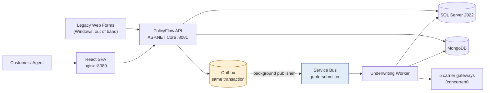

# PolicyFlow

PolicyFlow is a vendor-neutral auto-insurance modernization proof of concept
built to demonstrate a modern C#/.NET architecture operating alongside a legacy
compatibility boundary.

It demonstrates ASP.NET Core REST APIs, React, SQL Server, MongoDB,
asynchronous Azure Service Bus processing, a transactional outbox, idempotent
payments, Docker Compose, automated testing, and Azure DevOps CI/CD.

The scenario is an **auto-insurance marketplace**: a customer submits one
application, and the platform shops it against five carriers asynchronously,
returning up to fifteen priced coverage options with the full rating calculation
for each.

> ### Everything here is fictional
> The five carriers, their rating factors, discounts, financial-strength grades
> and every premium shown are **invented for demonstration**. Nothing in this
> repository represents real insurance pricing, a real rate filing, or a real
> company. The rating algorithms are deliberately simple so their output can be
> verified by hand.

---

## Contents

1. [Architecture](#architecture)
2. [Prerequisites](#prerequisites)
3. [Quick start](#quick-start)
4. [Local URLs](#local-urls)
5. [Walk the demo](#walk-the-demo)
6. [Docker commands](#docker-commands)
7. [Test commands](#test-commands)
8. [Database migrations](#database-migrations)
9. [The legacy Web Forms project](#the-legacy-web-forms-project)
10. [Azure DevOps setup](#azure-devops-setup)
11. [Optional Azure setup](#optional-azure-setup)
12. [Troubleshooting](#troubleshooting)
13. [Documentation](#documentation)

---

## Architecture



| Layer | Technology |
|---|---|
| Frontend | React 19, Vite 8, TypeScript 6 — responsive, mobile-first |
| API | ASP.NET Core 10, REST, OpenAPI, JWT, rate limiting |
| Worker | .NET 10 Worker Service, Service Bus consumer |
| Relational | SQL Server 2022 + EF Core 10, migrations, unique constraints, `rowversion` |
| Document | MongoDB 8 + EF Core MongoDB provider |
| Messaging | Azure Service Bus (Microsoft's local emulator) |
| Legacy | ASP.NET Web Forms, .NET Framework 4.8 (Windows only) |

**Read `docs/ARCHITECTURE.md`** for the reasoning behind each choice — why two
data stores, why `202` rather than `201`, why the outbox ordering matters, and
what is simulated versus real.

---

## Prerequisites

| Tool | Version | Notes |
|---|---|---|
| Docker Desktop | 4.x+ | Linux containers, ~6 GB free RAM |
| .NET SDK | **10.0+** | Only needed to run tests or migrations outside Docker |
| Node.js | 20+ | Only needed for frontend development |

Docker alone is enough to run the whole demo.

> **Windows note.** SQL Server and the Service Bus emulator are Linux containers,
> so Docker Desktop must be in Linux-container mode.

---

## Quick start

```bash
# 1. Create your local environment file
cp .env.example .env
```

Then **edit `.env`** and replace every `<placeholder>`. At minimum:

```bash
MSSQL_SA_PASSWORD=<8+ chars, upper, lower, digit, symbol>
MONGO_INITDB_ROOT_PASSWORD=<strong local password>
JWT_SIGNING_KEY=<32+ characters>
SERVICEBUS_CONNECTION_STRING=Endpoint=sb://servicebus-emulator;SharedAccessKeyName=RootManageSharedAccessKey;SharedAccessKey=SAS_KEY_VALUE;UseDevelopmentEmulator=true;
```

Both connection strings must embed the same passwords you set above — see the
comments in `.env.example`.

```bash
# 2. Start everything
docker compose up --build
```

First run takes 5–10 minutes (image pulls and builds). Startup order is gated on
health checks, so the API waits for SQL Server and MongoDB, and the worker waits
for the API.

```bash
# 3. Confirm it is up
curl http://localhost:8081/health/ready
```

All three checks should report `Healthy`. Then open **http://localhost:8080**.

`.env` is git-ignored and excluded from the Docker build context. No credential
is committed anywhere in this repository.

---

## Local URLs

| URL | What |
|---|---|
| http://localhost:8080 | **React SPA** — start here |
| http://localhost:8080/lookup | Mobile quote lookup |
| http://localhost:8080/agent | **Agent workspace** — sign in, submit quotes, track your own quotes |
| http://localhost:8080/underwriting | **Underwriter work queue — React** (modern SPA) |
| http://localhost:4200 | **Underwriter work queue — Angular**, the module from the legacy portal (`npm start` in `src/legacy/PolicyFlow.Legacy.Underwriting`) |
| http://localhost:8081/swagger | OpenAPI (Development only) |
| http://localhost:8081/health/ready | Readiness with per-dependency detail |
| http://localhost:8081/api/carriers | The carrier panel |
| localhost:1433 | SQL Server (`sa` + your password) |
| localhost:27017 | MongoDB |
| localhost:5672 | Service Bus AMQP |

---

## Walk the demo

### In the browser

1. **http://localhost:8080** — the landing page shows the live carrier panel,
   read from MongoDB.
2. **Start a quote.** Defaults are fine. Submit.
3. Watch **Pending → Processing → Rated**. This is the asynchronous pipeline; the
   page polls every 1.5s and stops at a terminal state.
4. **Fifteen offers**, cheapest first, filterable by coverage tier. Expand *"How
   this price was calculated"* on any card for the full rating trace.
5. **Buy a policy** on any offer.
6. **Pay**, then press **"Submit the same payment again"**. The second response
   returns the *original* transaction with a duplicate warning, and the payment
   history still shows **one** row.

**Resize to phone width**, or open on a real phone at
`http://<your-ip>:8080/lookup`, and look up the quote by number + surname.

### The agent's side

**http://localhost:8080/agent** — an agent signs in with any agent ID (the
simulated identity provider issues a token; there is no password), submits quotes
for clients, and sees every quote *they* submitted with its live status: the list
refreshes itself while underwriting runs and stops once each quote has an outcome.
Quotes are attributed from the token, so a second agent signing in sees only
their own. **View** opens the quote's comparison page.

### The underwriter's side (Angular, in the legacy portal)

Referred quotes land in an underwriter work queue — an Angular module hosted by
the legacy portal's `Underwriting.aspx`. To run it without IIS:

```bash
cd src/legacy/PolicyFlow.Legacy.Underwriting
npm ci
npm start                     # http://localhost:4200, proxies /api to :8081
```

1. Submit a quote with **prior insurance 0 months** so it is referred.
2. Open **http://localhost:4200** and select it in the queue.
3. The review form shows the application read-only, the rule that referred it,
   and which carriers would price it on approval.
4. **Approve** — the carrier panel prices it and the quote becomes Rated; look it
   up at `/lookup` in the SPA and it can now be bought. **Request follow-up** keeps
   it in the queue and shows the applicant your note. **Decline** closes it.

The **same work queue is built in React** at **http://localhost:8080/underwriting**
(no extra step — it is part of the SPA). Both call the same `/api/underwriting`
endpoints and neither holds a rule, so they behave identically; open them side by
side to compare the frameworks. `docs/LEGACY-MODERNIZATION.md` has the
concern-by-concern comparison.

### From the command line

```bash
# Submit
QID=$(curl -s -X POST http://localhost:8081/api/quotes \
  -H "Content-Type: application/json" -H "X-Correlation-Id: demo-1" \
  -d '{"customerName":"Alex Johnson","state":"GA","vehicleYear":2024,
       "vehicleMake":"Toyota","vehicleModel":"Camry",
       "annualMileage":12000,"priorInsuranceMonths":36}' \
  | python -c "import sys,json; print(json.load(sys.stdin)['quoteId'])")

# Poll (returns Pending, then Processing, then Rated)
curl -s http://localhost:8081/api/quotes/$QID

# The comparison
curl -s http://localhost:8081/api/quotes/$QID/offers

# Trace one correlation id across BOTH processes
docker compose logs api    | grep demo-1
docker compose logs worker | grep demo-1
```

### Behaviours you can trigger on purpose

| Input | What happens |
|---|---|
| `priorInsuranceMonths: 0` | **Referral** — no carrier is shopped at all |
| `priorInsuranceMonths: 3` | **Partial panel** — most carriers decline on appetite |
| `state: "FL"` | BlueRidge drops off (not licensed there) |
| `vehicleYear: 1995` | **Declined** |
| `customerName: "FAIL-DEPENDENCY"` | Verification fails → retried, `DeliveryCount` 1→5, then dead-lettered |
| `customerName: "FAIL-CARRIER"` | Every carrier gateway fails → all marked unavailable |

`docs/DEMO-SCRIPT.md` is a timed five-minute walkthrough.

---

## Docker commands

```bash
docker compose up --build          # build and start everything
docker compose up -d               # start detached
docker compose ps                  # status and health
docker compose logs -f api         # follow API logs
docker compose logs -f worker      # follow worker logs
docker compose logs -f             # both, interleaved — best for tracing
docker compose restart worker      # restart one service
docker compose down                # stop, KEEP data
docker compose down -v             # stop and DISCARD all data
```

### Reset the database

```bash
docker compose down -v
docker compose up --build
```

Named volumes mean `down` preserves data and `down -v` deliberately destroys it.
Migrations re-apply and the carrier catalog re-seeds on the next start.

---

## Test commands

### Backend

```bash
dotnet restore
dotnet build
```

Domain and application tests need nothing running:

```bash
dotnet test tests/PolicyFlow.Domain.Tests        # 167 tests, ~150ms
dotnet test tests/PolicyFlow.Application.Tests   # 125 tests
```

**Integration tests require real SQL Server** — that is the point of them. The
guarantees they cover (payment idempotency, duplicate-bind prevention,
`rowversion` concurrency) are enforced by unique indexes that an in-memory
provider does not have.

```bash
docker compose up -d sql

# Bash
export MSSQL_SA_PASSWORD=$(grep '^MSSQL_SA_PASSWORD=' .env | cut -d= -f2-)

# PowerShell
$env:MSSQL_SA_PASSWORD = (Get-Content .env | Select-String '^MSSQL_SA_PASSWORD=').ToString().Split('=',2)[1]

dotnet test tests/PolicyFlow.Api.IntegrationTests   # 92 tests
```

Each run creates and drops its own database, so runs never interfere.

```bash
dotnet test    # all 384
```

### Frontend

```bash
cd src/PolicyFlow.Web
npm ci
npm run lint
npm run test:ci     # 104 tests with coverage
npm run build
```

The Angular underwriting module (legacy portal):

```bash
cd src/legacy/PolicyFlow.Legacy.Underwriting
npm ci
npm run test:ci     # 67 tests
npm run build       # into PolicyFlow.Legacy.WebForms/Scripts/underwriting
```

### What the tests actually prove

| Suite | Count | Notable |
|---|---|---|
| `PolicyFlow.Domain.Tests` | 167 | Every rating rule and boundary; every state transition, including underwriter decisions; culture-independent trace rendering |
| `PolicyFlow.Application.Tests` | 125 | Redelivery is a no-op; legacy and modern channels rate identically; an approved referral prices exactly as the rating service does |
| `PolicyFlow.Api.IntegrationTests` | 92 | **20 concurrent payments → 1 row**; 10 concurrent binds → 1 policy; **5 concurrent underwriter decisions → 1 recorded**; an agent never sees another agent's quotes; no stack traces leak |
| `PolicyFlow.Web` (Vitest) | 104 | Retry reuses the idempotency key; polling stops at a terminal state; the work queue ignores a stale response and a double-click; the agent token is never sent to customer or underwriter calls |
| `PolicyFlow.Legacy.Underwriting` (Vitest) | 67 | A slow response cannot show the wrong quote; a 409 reloads what changed; Enter cannot post back the Web Forms page |

---

## Database migrations

```bash
dotnet tool install --global dotnet-ef
```

Migrations are applied automatically at startup **in Development only** —
`StartupTasks` refuses otherwise, so a deployed environment cannot silently alter
its own schema.

To run them manually:

```bash
# Bash
export SQL_CONNECTION_STRING="Server=localhost,1433;Database=PolicyFlow;User Id=sa;Password=<your-password>;TrustServerCertificate=True;Encrypt=True"

dotnet ef database update \
  --project src/PolicyFlow.Infrastructure \
  --startup-project src/PolicyFlow.Infrastructure
```

To add one:

```bash
dotnet ef migrations add <Name> \
  --project src/PolicyFlow.Infrastructure \
  --startup-project src/PolicyFlow.Infrastructure \
  --output-dir Persistence/Migrations
```

`--startup-project` is the infrastructure project itself, not the API:
`DesignTimeDbContextFactory` supplies the context, so the tooling does not need
MongoDB, Service Bus or anything else the API host wires up.

**MongoDB has no migrations** — the provider does not support them. Collections
are created on first write and indexes are created explicitly at startup by
`MongoIndexInitializer`.

### Verifying the schema

```bash
docker exec policyflow-sql /opt/mssql-tools18/bin/sqlcmd \
  -S localhost -U sa -P "$MSSQL_SA_PASSWORD" -C -d PolicyFlow \
  -Q "SELECT t.name, i.name, i.is_unique FROM sys.indexes i
      JOIN sys.tables t ON i.object_id = t.object_id
      WHERE i.is_unique = 1 ORDER BY t.name"
```

You should see `UX_Payments_PolicyId_IdempotencyKey` and `UX_Policies_QuoteId` —
the two constraints the transaction-safety claims rest on.

---

## The legacy Web Forms project

`src/legacy/PolicyFlow.Legacy.WebForms/` is a real ASP.NET Web Forms application
— `.aspx` markup, code-behind, ViewState, postbacks, an `UpdatePanel` + `Timer`
polling loop — retrofitted to call the modern API instead of holding business
logic.

**It is excluded from `PolicyFlow.slnx`, the Docker images and CI.** Web Forms
requires the full .NET Framework and `System.Web`, which exist only on Windows;
it cannot run in the Linux containers this POC uses, and `POC-INSTRUCTIONS.md`
§14 says explicitly not to try. Excluding it keeps `dotnet build` and CI green
everywhere.

To build it (Windows only — requires the **.NET Framework 4.8 Developer Pack**):

```bash
msbuild src/legacy/PolicyFlow.Legacy.sln /p:Configuration=Debug
```

It lives in its own solution, kept out of the repository root so a bare
`dotnet build` stays unambiguous. A `src/legacy/Directory.Build.props` shadows the
repository-root build properties, because a .NET Framework 4.8 project must not
inherit `<Nullable>enable</Nullable>` or a `net10.0` target framework.

To validate the `.aspx` markup, the `Inherits=` wiring and every control ID
against its designer field:

```bash
"C:\Windows\Microsoft.NET\Framework64\v4.0.30319\aspnet_compiler.exe" \
  -p src/legacy/PolicyFlow.Legacy.WebForms -v / "$env:TEMP\policyflow-precompile"
```

`msbuild`'s **publish** target additionally needs Visual Studio's *ASP.NET and web
development* workload (`Microsoft.WebApplication.targets`). The project emits a
clear warning if it is absent rather than failing; compiling and precompiling
work without it.

Then run it under IIS Express against a running API. `Web.config` already points
at the Docker API:

```xml
<add key="PolicyFlow.ApiBaseAddress" value="http://localhost:8081" />
```

From Visual Studio press F5 (`https://localhost:44390`), or from a terminal:

```powershell
cd src/legacy/PolicyFlow.Legacy.Underwriting; npm ci; npm run build; cd ../../..
& "$env:ProgramFiles\IIS Express\iisexpress.exe" /path:"$PWD\src\legacy\PolicyFlow.Legacy.WebForms" /port:8095 /clr:v4.0
# http://localhost:8095/Underwriting.aspx
```

Both origins must be in the API's `CORS_ALLOWED_ORIGINS` (the defaults include
them); a `.env` created before this was added needs the line updated.

Both channels write to the same SQL Server, so a quote submitted in the legacy
portal appears in the React SPA and vice versa.

**`Underwriting.aspx` hosts an Angular module** rather than being another Web
Forms page: the underwriter work queue in `src/legacy/PolicyFlow.Legacy.Underwriting`.
Build it with `npm run build` there before running the portal (the page says so if
you forget). It calls `/api/underwriting` directly, cross-origin from IIS Express,
which is why `CORS_ALLOWED_ORIGINS` includes `https://localhost:44390`. It also
runs standalone on the Angular dev server — see *The underwriter's side* above.

**`docs/LEGACY-MODERNIZATION.md`** explains the seam, the page lifecycle,
ViewState costs, and the seven-step migration strategy — and the two tests that
prove the two channels cannot drift apart.

---

## Azure DevOps setup

`azure-pipelines.yml` runs backend build and tests, frontend lint/test/build,
Docker validation, and artifact publication.

1. Push the repository to Azure Repos.
2. **Pipelines → New pipeline → Azure Repos Git →** select the repo →
   *Existing Azure Pipelines YAML file* → `/azure-pipelines.yml`.
3. Run it once to confirm it is green.
4. **Repos → Branches → `main` → Branch policies**, then configure:
   - Minimum reviewers: **1**
   - Check for linked work items: optional
   - Check for comment resolution: **required**
   - **Build validation**: add the pipeline, trigger **Automatic**, policy
     **Required**
5. Create a feature branch, open a PR, and confirm validation blocks the merge
   until it passes.

PR validation comes from the **branch policy**, not a YAML `pr:` trigger — that
is the Azure Repos convention.

`docs/DEVOPS.md` has the detail.

---

## Optional Azure setup

The POC runs entirely locally and does not require a paid Azure footprint.

- **`infra/azure/main.bicep`** describes a minimal Container Apps environment.
  It is not deployed by CI; infrastructure deployment is an explicit, manual
  step.
- **Azure SQL free offer** can host the relational store: create a `CloudDev`
  configuration, store the connection string as a secret pipeline variable, run
  migrations, verify connectivity. Never commit it.
- For **strict zero cost**, keep the runtime local and use Azure DevOps only for
  CI/CD.

See `infra/azure/README.md` for cost warnings before deploying anything.

---

## Troubleshooting

`docs/TROUBLESHOOTING.md` covers these in depth. The common ones:

**`MSSQL_SA_PASSWORD is required`** — you have not created `.env`. Run
`cp .env.example .env` and fill in the placeholders.

**SQL Server container exits immediately** — the password does not meet
complexity requirements (8+ chars, upper, lower, digit, symbol), or the host has
under ~2 GB free for the container.

**Quote stays `Pending` forever** — the outbox is not draining. Check
`docker compose logs api | grep -i outbox` and
`curl http://localhost:8081/health/ready`. Usually the Service Bus emulator is
not up, or `SERVICEBUS_CONNECTION_STRING` is wrong.

**`service-bus` is Unhealthy** — the emulator needs SQL Server; check
`docker compose logs servicebus-emulator` for the queue-creation lines.

**Port already in use** — override in `.env`:
`WEB_HTTP_PORT=9080`, `API_HTTP_PORT=9081`.

**Comparison shows `baseline: null` and `ratingMs: 0`** — MongoDB was unreachable
during underwriting, so the API is serving the SQL fallback. Correct behaviour,
but check `docker compose logs worker | grep -i comparison`.

**Everything is broken and you want a clean slate:**

```bash
docker compose down -v
docker compose up --build
```

---

## Documentation

| Document | Contents |
|---|---|
| `docs/ARCHITECTURE.md` | Design decisions and their reasoning; what is simulated |
| `docs/API.md` | Full endpoint reference with request/response examples |
| `docs/LEGACY-MODERNIZATION.md` | The seam, Web Forms mechanics, migration strategy |
| `docs/SECURITY.md` | Controls implemented, and every production gap |
| `docs/DEMO-SCRIPT.md` | Timed five-minute walkthrough |
| `docs/INTERVIEW-TALKING-POINTS.md` | Defensible positions on each architectural choice |
| `docs/TROUBLESHOOTING.md` | Diagnosis by symptom |
| `docs/DEVOPS.md` | Pipeline stages and branch policy |
| `docs/PROGRESS.md` | Phase-by-phase build record |
| `POC-INSTRUCTIONS.md` | The original specification |

---

## Repository layout

```
PolicyFlow/
├── PolicyFlow.slnx                    # main solution (cross-platform)
├── PolicyFlow.Legacy.sln              # legacy solution (Windows only)
├── docker-compose.yml
├── azure-pipelines.yml
├── .env.example                        # placeholders only; .env is git-ignored
│
├── src/
│   ├── PolicyFlow.Domain/              # entities, state machines, rating rules
│   ├── PolicyFlow.Application/         # use cases and ports
│   ├── PolicyFlow.Infrastructure/      # EF Core + SQL Server, outbox, Service Bus
│   ├── PolicyFlow.Infrastructure.NoSql/# EF Core + MongoDB
│   ├── PolicyFlow.Api/                 # REST, legacy seam, security, health
│   ├── PolicyFlow.Worker/              # Service Bus consumer, carrier fan-out
│   ├── PolicyFlow.Web/                 # React SPA
│   └── legacy/
│       ├── PolicyFlow.Legacy.WebForms/ # .NET Framework 4.8, Windows only
│       └── PolicyFlow.Legacy.Underwriting/ # Angular 22 module hosted by Underwriting.aspx
│
├── tests/
│   ├── PolicyFlow.Domain.Tests/        # 161
│   ├── PolicyFlow.Application.Tests/   # 119
│   └── PolicyFlow.Api.IntegrationTests/# 86, real SQL Server
│
├── infra/
│   ├── servicebus/config.json          # emulator namespace and queue
│   └── azure/main.bicep                # optional, not deployed by CI
│
└── docs/
```
