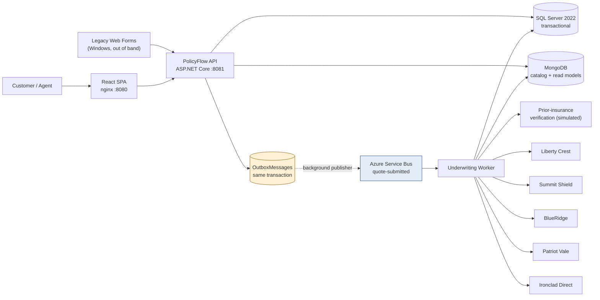
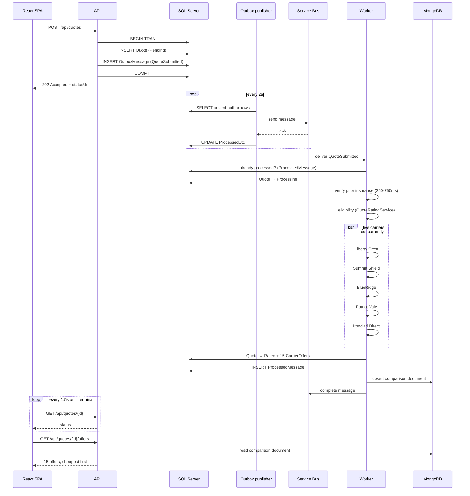
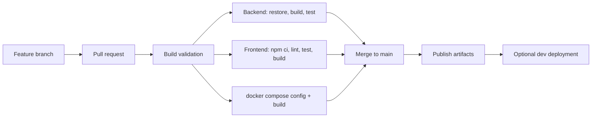

# Architecture

PolicyFlow is an auto-insurance quote marketplace. A customer submits one
application; the platform shops it against five carriers asynchronously and
returns up to fifteen priced coverage options.

> Every carrier, rating factor and premium in this system is **fictional**. The
> algorithms exist to produce deterministic, hand-verifiable numbers, not to
> model real insurance pricing.

---

## Context



---

## Projects

| Project | Framework | Responsibility |
|---|---|---|
| `PolicyFlow.Domain` | .NET 10 | Entities, state machines, rating rules. **No dependencies on anything.** |
| `PolicyFlow.Application` | .NET 10 | Use cases, ports (interfaces), orchestration |
| `PolicyFlow.Infrastructure` | EF Core 10 + SQL Server | Relational persistence, outbox, Service Bus |
| `PolicyFlow.Infrastructure.NoSql` | EF Core 10 + MongoDB | Carrier catalog, comparison read models |
| `PolicyFlow.Api` | ASP.NET Core 10 | REST, legacy seam, security, health, OpenAPI |
| `PolicyFlow.Worker` | .NET 10 Worker | Service Bus consumer, carrier fan-out |
| `PolicyFlow.Web` | React 19 + Vite + TS | Responsive SPA |
| `legacy/PolicyFlow.Legacy.WebForms` | .NET Framework 4.8 | Legacy portal (Windows only, excluded from build) |

Dependencies point inward. `Domain` references nothing; `Application` references
only `Domain`; the infrastructure projects implement `Application`'s interfaces.
The practical payoff: `PolicyFlow.Domain.Tests` runs 130 tests in 130 ms with no
database, no host and no mocks.

---

## The quote lifecycle



### Why `202`, not `201`

The quote exists; its price does not. Underwriting calls a verification bureau
and five carrier gateways — roughly 1.5–3 seconds of third-party latency.
Holding an HTTP request open for that would tie a customer's page load to the
slowest third party in the chain, and would make the API's capacity a function
of someone else's uptime.

Observed on a real run: `FanOutMs=564` while individual carriers took 215–562 ms.
The fan-out is concurrent, so the panel costs roughly the slowest carrier rather
than the sum of all five (~1,969 ms).

---

## Two data stores, on purpose

| | SQL Server 2022 | MongoDB |
|---|---|---|
| **Holds** | Quotes, offers, policies, payments, outbox, dedup ledger | Carrier catalog, comparison read models |
| **Needs** | ACID transactions, referential integrity, unique constraints | Flexible nested documents, cheap denormalised reads |
| **Source of truth** | **Yes** | No — it is a cache |
| **Access** | EF Core + SQL Server provider | EF Core + MongoDB provider |
| **If it is down** | The API is unhealthy | The API is *degraded*; it falls back |

Both are managed through EF Core, so the same `DbContext` model, change tracking
and LINQ apply to both.

### Why the catalog is a document

Carrier configuration is deeply nested and **ragged**. Each carrier has a
different set of state factors, a different discount list, and may file different
coverage tiers. Relationally that is several child tables and a join per read,
and a carrier-specific factor means a schema migration.

As a document, one carrier is one document read in one round trip, and a new
factor is a new field. It is also read-mostly and needs no transaction, so it
does not belong in the store that provides one.

Pricing configuration living in the catalog is verifiable, not decorative:
`UnderwriteQuoteHandlerTests.CatalogPricingChange_ChangesThePremium` edits the
catalog and asserts the next quote prices differently.

### Why the comparison is a document

The comparison screen needs, for up to fifteen offers: premium, limits,
deductible, discount list, rating trace, carrier branding — plus a "carriers that
did not quote" list. Relationally that is a join across three tables plus a
computed set difference, on the screen most likely to be opened on a phone.

As a document it is one index seek returning exactly the shape the UI renders.

### The cache discipline

Because the read model is a cache and not a source of truth, three rules hold:

1. A failed **write** is logged and swallowed. The relational record has already
   committed; throwing would cause the Service Bus message to be retried and the
   quote re-underwritten — trading a cache miss for real data corruption.
2. A failed **read** falls back to projecting from SQL
   (`GetQuoteOffersHandler.ProjectFromRelationalAsync`). Slower, but correct.
3. Money is re-read from SQL before anything binds or charges. BSON has no
   decimal128 mapping in this provider version, so the document stores doubles;
   the authoritative cent-exact value is `decimal(18,2)` in SQL.

`ReadModelWriteFailure_DoesNotFailUnderwriting` and
`GetOffers_FallsBackToSqlWhenTheReadModelIsUnavailable` enforce 1 and 2.

### Transactions are disabled on the Mongo context

`Database.AutoTransactionBehavior = AutoTransactionBehavior.Never`. The provider
wraps `SaveChanges` in a transaction by default, and MongoDB supports
transactions only on a replica set. Against a standalone container every write
throws.

Running a single-node replica set would restore them but adds `rs.initiate()`
orchestration and a slower startup. Disabling is correct here because every
`SaveChanges` on this context writes exactly **one** document — already atomic in
MongoDB — and seeding is idempotent by carrier id. A document store holding money
or multi-document invariants would need the replica set.

---

## Reliability

### The transactional outbox

The gap this closes: if the API committed the quote and **then** published to
Service Bus, a crash between the two would leave a `Pending` quote nobody will
ever underwrite. No error, no alert — just a customer who never gets a price.

Writing the event to `OutboxMessages` **in the same transaction** makes "quote
saved" and "event will be sent" a single atomic fact.

The ordering in `OutboxPublisherService` is the entire point and is easy to get
backwards:

1. Read unsent rows (`ProcessedUtc IS NULL`).
2. Send to the broker and **wait for the acknowledgement**.
3. *Only then* stamp `ProcessedUtc` and commit.

Marking processed before the send reintroduces exactly the gap the outbox exists
to close. In this order, a crash causes a **re-send** — the message is delivered
twice, which is safe, because the consumer deduplicates.

This is why delivery is at-least-once and never exactly-once. Exactly-once across
a database and a broker is not achievable without distributed transactions; the
practical answer is at-least-once plus an idempotent consumer.

### Idempotent consumption

Three independent layers, cheapest first:

| Layer | Mechanism | Handles |
|---|---|---|
| 1 | `ProcessedMessage` PK seek on `(MessageId, Consumer)` | The common redelivery |
| 2 | `Quote` state machine refuses a terminal→terminal transition | A ledger read that misses |
| 3 | Composite PK violation on insert | Two workers racing |

The composite key is deliberate. Keying on `MessageId` alone would mean a second,
unrelated consumer of the same event could never process it — a bug that only
appears the day a second subscriber is added.

### Transient vs permanent failure

These need opposite responses, and conflating them is a common source of either
lost work or infinite retry loops.

| Failure | Response | Why |
|---|---|---|
| `DependencyUnavailableException` | **Abandon** → redelivered | The bureau is expected to recover |
| `DomainException` | **Dead-letter** immediately | Every retry fails identically |
| Quote row not found | **Dead-letter** | The row is not coming back |
| Shutdown mid-message | **Abandon** | Pick it up after restart |
| Anything unrecognised | **Abandon** | May be transient; Service Bus dead-letters at `MaxDeliveryCount` |

Verified live: `FAIL-DEPENDENCY` escalates `DeliveryCount` 1→5 and is then
dead-lettered by the broker.

### One slow carrier cannot break the panel

`SimulatedCarrierRatingGateway` catches per-carrier failures and returns
`CarrierQuoteResult.Unavailable` instead of throwing. The panel comes back short
with the carrier marked unavailable, rather than the whole quote failing.

Latency is simulated with `Task.Delay`, never `Thread.Sleep`. A blocking sleep
consumes a thread-pool thread per carrier; with a five-way fan-out under load,
that is how a service starves itself.

---

## Payment idempotency

The demo's centrepiece. Duplicate payment requests are not hypothetical: users
double-click, mobile networks retry, load balancers replay, and **a client that
times out cannot distinguish a lost request from a lost response.**

Three layers, in order of strength:

```
1. UNIQUE INDEX UX_Payments_PolicyId_IdempotencyKey   ← the actual guarantee
2. Pre-read for the existing key                       ← fast path for a retry
3. Catch the unique violation → return the original    ← when the pre-read races
```

**The index is the guarantee.** The pre-read cannot survive two concurrent
requests on two servers; the index can.
`ConcurrentPaymentsWithTheSameKey_CollapseToOneTransaction` fires twenty
simultaneous requests and asserts one row.

Scope is `(PolicyId, IdempotencyKey)`, not the key alone. Keys are chosen by
clients, so two customers could independently pick the same one; a globally
unique index would reject a legitimate second payment.

Disabling a UI button is not a substitute. By the time a request has timed out it
has already reached the server, and the next client will not have that button
at all.

---

## SQL Server schema

Constraints, not conventions. The schema enforces business integrity.

| Index | Type | Purpose |
|---|---|---|
| `UX_Quotes_QuoteNumber` | UNIQUE | Customer-facing id cannot collide |
| `UX_Policies_PolicyNumber` | UNIQUE | Same |
| `UX_Policies_QuoteId` | UNIQUE | **A quote can back at most one policy** |
| `UX_Payments_PolicyId_IdempotencyKey` | UNIQUE | **The idempotency guarantee** |
| `UX_CarrierOffers_Quote_Carrier_Tier` | UNIQUE | One offer per carrier/tier/quote |
| `UX_NumberSequences_Name_Year` | UNIQUE | Serialisation point for number allocation |
| `PK_ProcessedMessages` | composite PK | Consumer-side dedup |
| `IX_OutboxMessages_ProcessedUtc_OccurredUtc` | **filtered** `WHERE ProcessedUtc IS NULL` | Publisher's hot query reads only pending rows |
| `IX_Quotes_QuoteNumber_CustomerName` | covering | Mobile self-service lookup |
| `IX_CarrierOffers_QuoteId_AnnualPremium` | covering | Comparison read, cheapest first |

The filtered outbox index matters at volume: a processed message leaves the index
entirely, so it stays small no matter how many million rows accumulate behind it.

`rowversion` on `Quotes` and `Policies` gives optimistic concurrency — EF Core
includes it in the `WHERE` clause, so a lost update raises
`DbUpdateConcurrencyException` (mapped to 409) instead of silently overwriting.

Money is `decimal(18,2)`, never float. Binary floating point cannot represent
cents exactly, and premiums are summed and compared.

### Number allocation

`NextValueAsync` reads the counter row `WITH (UPDLOCK, HOLDLOCK)` inside the
caller's transaction. Without those hints, two concurrent submissions read the
same `LastValue` and both claim the same number; the unique index rejects the
loser and the customer sees a 500 for no reason they can act on.

### The execution-strategy requirement

`UnitOfWork.ExecuteInTransactionAsync` wraps its work in
`Database.CreateExecutionStrategy()`. This is mandatory, not stylistic: the
provider is configured with `EnableRetryOnFailure`, and a retrying strategy
refuses a user-initiated transaction unless the whole transaction sits inside the
retriable unit. Without it, every quote submission throws
`SqlServerRetryingExecutionStrategy does not support user-initiated
transactions`.

It is also the correct semantics — a transient fault retries the *entire*
operation rather than retrying a commit on a transaction that already rolled
back. The consequence is that the delegate must be idempotent, which the callers
satisfy by re-deriving everything inside it.

---

## Rating

Two models, deliberately disagreeing.

**`QuoteRatingService`** — eligibility gates plus a flat-surcharge baseline from
`POC-INSTRUCTIONS.md` §9. Base $900; `+175` new vehicle, `+200` high mileage,
`+300` thin prior coverage, `+100` out of home state. Zero prior insurance →
**Referral**; vehicle over 25 model years → **Declined**.

**`CarrierRatingService`** — multiplicative per-carrier factors, per tier, with
discounts capped at 30%:

```
premium = carrier.BaseAnnualPremium
        × stateFactor
        × (newVehicle      ? NewVehicleFactor        : 1)
        × (highMileage     ? HighMileageFactor       : 1)
        × (thinPriorMonths ? ThinPriorCoverageFactor : 1)
        × tierFactor
        × (1 − totalDiscountPercentage)
```

They disagree because that is the point of a comparison screen. The house
baseline is a reference figure; the carrier panel is what the customer can buy.

Rating is **deterministic** — no randomness anywhere, including the simulated
latency, which is derived from the quote id. Without that the demo would not be
reproducible and the numbers could not be checked by hand. Enforced by
`RatingIsDeterministic_SameInputProducesSamePremium`.

Every offer carries a `RatingTrace`: the ordered list of steps that produced the
price, shown in an expandable panel in the UI.

### Carrier appetite

A rated quote may carry fewer than fifteen offers, which is correct behaviour
rather than a defect:

| Carrier | Min. prior coverage | Max. mileage | Does not write |
|---|---|---|---|
| Liberty Crest | 0 | 30,000 | — |
| Summit Shield | 6 | 25,000 | AL, MS |
| BlueRidge | 0 | 20,000 | **FL, TX** |
| Patriot Vale | 0 | 40,000 | — |
| Ironclad Direct | 12 | 22,000 | AL, MS |

A Florida quote loses BlueRidge; a 3-month coverage history loses Summit Shield
and Ironclad. Patriot Vale is the non-standard market and is the reason a
lapsed-coverage customer still sees an offer.

If **no** carrier has appetite, the quote is **referred** — never priced anyway.

---

## Observability

One correlation id flows from the HTTP request, into the SQL rows, onto the
Service Bus message, and into the worker's logs. That is what turns "the site
broke" into a single log query.

A supplied `X-Correlation-Id` is **validated before use**. It lands in log output
and a response header, so an unvalidated value is a log-injection and
header-injection vector: a newline would let a caller forge log lines. Anything
that is not ≤64 chars of `[A-Za-z0-9._:-]` is replaced with a generated GUID
rather than rejected — a bad trace id is no reason to fail a customer's quote.

Logging is structured, so `ElapsedMs` and `CarrierId` are queryable fields rather
than text. Standard fields: `Operation`, `CorrelationId`, `QuoteId`,
`QuoteNumber`, `PolicyId`, `MessageId`, `ElapsedMs`, `Result`.

Never logged: bearer tokens, the `Idempotency-Key` (client-chosen, could contain
anything), request bodies, connection strings.

### Health probes

| Endpoint | Checks | Rationale |
|---|---|---|
| `/health/live` | Nothing | A liveness probe that checks the database restarts a healthy container during a database blip |
| `/health/ready` | SQL, Mongo, Service Bus | Keeps a starting instance out of the load balancer until dependencies are reachable |

Mongo reports **Degraded**, not Unhealthy — there is a fallback, and pulling a
working instance for a degradation would be wrong. Service Bus reports
**Unhealthy** — without it, quotes are accepted but never underwritten.

The Service Bus probe is a **peek**, deliberately.
`ServiceBusAdministrationClient.QueueExistsAsync` is the obvious choice and does
not work: the local emulator implements only the AMQP data plane, so every check
would fail against a healthy queue. Sending a probe message would work but would
put junk on the queue the worker consumes. A peek neither locks nor removes.

---

## Frontend

React 19 + Vite 8 + TypeScript 6, served by nginx which reverse-proxies `/api`.
Proxying rather than calling cross-origin means same-origin requests: no CORS
preflight on every call, and no API hostname baked into the bundle at build time.

**Mobile-first.** Every base style targets a phone; media queries add layout as
the viewport grows. Concretely:

- 44px minimum touch targets, 16px minimum input font (below that, iOS Safari
  zooms the page when a field is focused, which makes a form feel broken)
- `100dvh` not `100vh` — `100vh` includes the retracting mobile URL bar
- The comparison grid is `auto-fit, minmax(min(100%, 280px), 1fr)`: one column on
  a phone, up to four on a desktop, no breakpoint arithmetic
- `overflow-x: hidden` on body, with wide tables in their own scroll container
- Pinch-zoom is **not** blocked — `maximum-scale` is an accessibility failure
- The mobile lookup returns status *and* the full comparison in one round trip,
  because a second request on a slow connection is a visible delay

**Polling, not websockets.** The right amount of machinery for a workflow that
finishes in ~2 seconds: no connection to keep alive, no reconnection logic, no
sticky sessions on a scaled-out API, and the status endpoint is one indexed
primary-key read. It stops on the server's own `isTerminal` flag rather than the
client re-deriving which statuses are final, and gives up after 30 attempts so a
broken backend surfaces as an error instead of an infinite poll.

---

## CI/CD



See `azure-pipelines.yml` and `docs/DEVOPS.md`.

---

## What is simulated, and what is real

Honesty about the boundary matters more than the simulation.

| Simulated | Real |
|---|---|
| Five carrier rating APIs (`Task.Delay` + deterministic arithmetic) | EF Core → SQL Server 2022, with migrations |
| Prior-insurance bureau (250–750 ms, `FAIL-DEPENDENCY` trigger) | Azure Service Bus (Microsoft's emulator, real AMQP) |
| Payment gateway (synthetic reference, no card data anywhere) | MongoDB via the official EF Core provider |
| Entra ID (local HS256 issuer) | JWT bearer validation, authorization policies, CORS, rate limiting |
| — | The transactional outbox, idempotent consumer, unique constraints |

Each simulated dependency is documented as POC-only in its own implementation
file, and each is behind an interface (`ICarrierRatingGateway`,
`IPriorInsuranceVerifier`, `IPaymentGateway`) so replacing it with an HTTP client
is a registration change.

What is faithfully modelled about the simulated dependencies is their **shape**:
they are remote, slow, independently failing, and must never be called from
inside a synchronous HTTP request.
