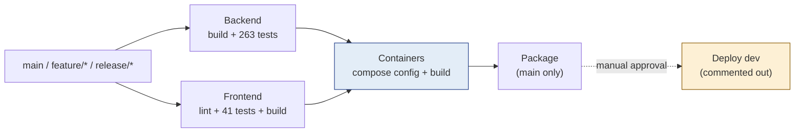

# DevOps

The Azure DevOps pipeline, and the branch policy that makes it a merge gate.

---

## Pipeline



| Stage | Runs | Gate |
|---|---|---|
| **Backend** | restore, build, domain tests, application tests, integration tests, publish API + worker | — |
| **Frontend** | `npm ci`, lint, tests + coverage, build | — |
| **Containers** | `docker compose config`, `docker compose build` | both code stages green |
| **Package** | assemble deployment files, **assert no `.env`** | `main` only |
| **DeployDev** | Bicep deployment | commented out; manual approval |

Backend and Frontend declare `dependsOn: []` so they run **in parallel** —
neither depends on the other, and it roughly halves wall-clock time. Containers
build only if both pass, because building images for a broken commit wastes
several minutes of agent time.

---

## Decisions worth explaining

### There is no `pr:` trigger, deliberately

For **Azure Repos Git**, pull-request validation is configured through a
**branch policy**, not in YAML.

A `pr:` trigger is the GitHub convention and is **silently ignored** by Azure
Repos. That is a good way to believe your pull requests are validated when they
are not — the pipeline appears in the run history from the CI trigger, so nothing
looks wrong.

### Integration tests run against real SQL Server

The Backend job declares a `sqlserver` service container. This is not
convenience — it is the point of that suite.

The guarantees that matter most in this system (payment idempotency,
duplicate-bind prevention, `rowversion` concurrency) are enforced by **unique
indexes**. Against an in-memory provider those tests would pass *without the
constraints existing at all*, which is worse than having no test because it gives
false confidence.

The SA password is generated per run from `$(Build.BuildId)` rather than stored
as a pipeline secret. It is a throwaway container that lives for the length of the
job; a managed secret for it would be one nobody needs.

The explicit **wait loop** matters: SQL Server in a container takes 30–60 seconds
to accept connections, and without it the first test fails with a connection
error that looks like a code bug. The loop turns that into a deterministic
failure with a clear message.

### `npm ci`, never `npm install`

`npm ci` installs exactly the locked versions and **fails** if the lockfile
disagrees with `package.json`. A CI build that silently resolves a different
dependency tree than the one that was tested is not a validation of anything.

### The secret check is code, not a comment

```bash
if find .../deploy -name '.env' -not -name '.env.example' | grep -q .; then
  echo "##vso[task.logissue type=error]A .env file was found..."
  exit 1
fi
```

A comment saying "don't commit secrets" would not have caught it. This fails the
pipeline if a `.env` ever reaches a downloadable artifact.

### Test results publish on failure

`condition: always()` on `PublishTestResults`. Test results are most valuable
precisely when the build failed; skipping publication on failure hides the reason
and forces a log dig.

### Deployment is manual and commented out

Container Apps has a free monthly grant, but ancillary resources — Log Analytics,
a container registry, public IPs — still cost money. Infrastructure deployment
should be an explicit decision behind an approval gate, not a side effect of
merging. See `infra/azure/README.md`.

Image tags use `$(Build.BuildId)`. Never `latest` alone: it makes rollback
impossible and the running version unidentifiable.

### Docs-only changes skip CI

```yaml
paths:
  exclude:
    - docs/**
    - '**/*.md'
```

A README edit does not need a container build, and keeping runs meaningful keeps
the free hosted-agent minutes useful.

---

## Caching

Two caches, both keyed on lockfile content so they invalidate when a dependency
changes and not on every source edit:

```yaml
key: 'nuget | "$(Agent.OS)" | **/*.csproj,!**/bin/**,!**/obj/**'
key: 'npm   | "$(Agent.OS)" | src/PolicyFlow.Web/package-lock.json'
```

The `restoreKeys` fallback means a changed dependency still gets a partial cache
hit rather than a cold restore.

---

## Setting up the pipeline

### 1. Push to Azure Repos

```bash
git remote add origin https://dev.azure.com/<org>/<project>/_git/<repo>
git push -u origin main
```

### 2. Create the pipeline

**Pipelines → New pipeline → Azure Repos Git →** select the repo →
**Existing Azure Pipelines YAML file** → `/azure-pipelines.yml` → Run.

Confirm it is green before configuring the policy. A required policy pointing at
a broken pipeline blocks every merge.

### 3. Configure the branch policy on `main`

**Repos → Branches → `main` → ⋯ → Branch policies:**

| Policy | Setting | Why |
|---|---|---|
| Require a minimum number of reviewers | **1** | Also prohibits direct pushes to `main` |
| Check for linked work items | optional | Traceability, if the project uses Boards |
| Check for comment resolution | **Required** | Review comments cannot be silently ignored |
| **Build validation** | add the pipeline | The gate itself |
| ↳ Trigger | **Automatic** | Runs on every PR update |
| ↳ Policy requirement | **Required** | Blocks the merge |
| ↳ Build expiration | After 12 hours | Re-validates against a moved target branch |

Enabling "Require a minimum number of reviewers" is what actually prohibits
direct pushes — there is no separate switch for it.

### 4. Prove it works

```bash
git checkout -b feature/prove-branch-policy
# make a small change
git commit -am "Verify branch policy blocks unvalidated merges"
git push -u origin feature/prove-branch-policy
```

Open a PR. Confirm:

- validation starts automatically
- **Complete** is disabled while it runs
- it becomes available only when the build is green

Then deliberately break a test, push, and confirm the merge is blocked. A policy
you have not seen block anything is a policy you do not know is working.

---

## Local pre-push check

Run what CI runs, before pushing:

```bash
# Backend
dotnet build PolicyFlow.slnx --configuration Release
dotnet test tests/PolicyFlow.Domain.Tests
dotnet test tests/PolicyFlow.Application.Tests

docker compose up -d sql
export MSSQL_SA_PASSWORD=$(grep '^MSSQL_SA_PASSWORD=' .env | cut -d= -f2-)
dotnet test tests/PolicyFlow.Api.IntegrationTests

# Frontend
cd src/PolicyFlow.Web && npm ci && npm run lint && npm run test:ci && npm run build && cd -

# Containers
docker compose config > /dev/null && docker compose build
```

---

## Adding a stage

Three things to get right:

**Dependencies.** `dependsOn: []` runs in parallel; naming a stage serialises.
Only serialise where there is a real dependency.

**Conditions.** `condition: succeeded()` is implicit but worth being explicit
about when combined with a branch check:

```yaml
condition: and(succeeded(), eq(variables['Build.SourceBranch'], 'refs/heads/main'))
```

**Timeouts.** Set `timeoutInMinutes` on every job. Without it a hung job consumes
agent minutes until the 60-minute default expires.

---

## What is not in the pipeline, and why

| Missing | Why | Would add |
|---|---|---|
| Dependency vulnerability scanning | Not required by the spec | `dotnet list package --vulnerable --include-transitive`, `npm audit --audit-level=high` |
| Static analysis / SonarQube | Adds a service dependency | A `SonarCloudPrepare`/`Analyze`/`Publish` triple |
| Container image scanning | No registry in this POC | Trivy or Microsoft Defender for Containers |
| Image push | Deployment is out of scope | `docker buildx` + `az acr login` |
| Load testing | Needs a deployed target | k6 or Azure Load Testing against a dev environment |
| End-to-end browser tests | The integration suite covers the API contract | Playwright against `docker compose up` |

Dependency scanning is the one I would add first. It is two commands, needs no
external service, and catches the class of problem least likely to be found by
review.
