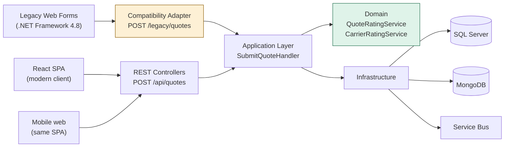

# Legacy Modernization

How PolicyFlow runs a legacy ASP.NET Web Forms application and a modern
React + .NET 10 platform side by side, against one set of business rules.

---

## The seam



Both channels converge on `SubmitQuoteHandler`. The adapter is **translation
only** — it holds no rating rules, no eligibility logic and no persistence.

### Why that constraint is the whole point

The failure mode in legacy modernization is not that the old system still
exists. It is **the same business rule existing twice.**

That is what actually happened to the system this POC is modelled on. Rating
lived in `QuoteEntry.aspx.cs` code-behind. When a mobile channel was needed, the
rules could not be called from anywhere else — they were entangled with
`txtMileage.Text` and a `Page` lifecycle — so they were copied. The two copies
then drifted, and the same customer received different prices depending on which
channel they used. Nobody noticed for months.

The adapter exists so that cannot recur. It is a thin, disposable translation
layer whose only job is to let the old client keep working until it is retired.

### Proof, not intent

Two tests enforce it, and they fail the build if a rule is ever duplicated:

| Test | What it asserts |
|---|---|
| `LegacyApiTests.LegacyAndModernSubmissions_ProduceIdenticalPricing` | Same risk through both contracts → identical status, premium, best carrier and offer count |
| `LegacyApiTests.LegacyOfferSets_MatchTheModernOfferSetsExactly` | All 15 carrier/tier/premium rows match exactly |

The only intentional difference is the recorded `Channel`
(`Modern` / `LegacyWebForms`), which exists so legacy traffic is visible in data
and logs — that is how you know when it is safe to switch the old UI off.

---

## The two contracts

The legacy contract is not a style choice. It is what the existing application
already posts, and changing it would mean a release of the legacy application, a
regression pass, and a deployment window — for no behavioural benefit.

### Legacy request → modern command

| Legacy field | Type | Modern field | Type | Translation |
|---|---|---|---|---|
| `InsuredName` | string | `customerName` | string | trim |
| `RiskState` | string | `state` | string | trim, upper-case |
| `VehYear` | string | `vehicleYear` | int | `int.TryParse` |
| `VehMake` | string | `vehicleMake` | string | trim |
| `VehModel` | string | `vehicleModel` | string | trim |
| `Mileage` | string | `annualMileage` | int | strip `,` then parse |
| `PriorCovMonths` | string | `priorInsuranceMonths` | int | `int.TryParse` |

Everything arrives as a string because Web Forms controls yield strings —
`TextBox.Text` has no type, so the legacy application never had typed values to
send. `Mileage` may carry a thousands separator (`"12,000"`) because the page
formats numbers for display and posts back what it shows.

### Modern result → legacy response

The legacy client predates `ProblemDetails` and cannot interpret a 4xx body, so
`POST /legacy/quotes` **always returns HTTP 200** and puts the outcome in a
numeric return code:

| `ReturnCode` | Meaning |
|---|---|
| `0` | Accepted for underwriting |
| `1` | Validation failure — `ReturnMessage` explains |
| `2` | System error (transport failure, set client-side) |

This is a deliberate concession, documented here and in `LegacyController` so
nobody later "fixes" it into a 400 and breaks the pages it exists to support.

Status is also exposed **by quote number**, not GUID
(`GET /legacy/quotes/{quoteNbr}`), because the legacy database only ever stored
the printed number. Requiring the GUID would have forced a schema change on the
legacy side — precisely the kind of cost this pattern avoids.

Premium comes back as a fixed-decimal **string** (`"1482.50"`), because the old
code does `CDec()` on whatever it receives.

---

## What the legacy project demonstrates

`src/legacy/PolicyFlow.Legacy.WebForms/` is a real Web Forms application, not a
sketch. It is worth opening to see the patterns being migrated away from.

### Page lifecycle

A Web Forms request runs a fixed sequence — `Init`, `LoadViewState`,
`LoadPostData`, `Load`, control events, `PreRender`, `SaveViewState`, `Render`,
`Unload` — and code-behind hooks into it. `Page_Load` fires on **every** request,
postback included, which is why almost every handler is wrapped in an
`if (!IsPostBack)` guard. Forget it, and you wipe the user's input on every
click. See `QuoteEntry.aspx.cs`.

The cost is testability. A rating rule in `btnSubmit_Click` cannot be exercised
without instantiating a `Page` with an `HttpContext`, so in practice it is never
unit tested at all.

### Postbacks

Every button is a full-page POST to the same URL, re-running the entire
lifecycle. There is no partial update, and there is only ever **one**
`<form runat="server">` per page — independent forms are impossible.

### ViewState

Control state round-trips in a hidden `__VIEWSTATE` field, sent up **and** down
on every postback. On `QuoteEntry.aspx` that is a few KB; on a page with a
populated `GridView` it routinely reached hundreds of KB per click.

`QuoteStatus.aspx` makes the cost concrete. It polls for the underwriting result
using `<asp:Timer>` inside an `<asp:UpdatePanel>` — the pre-SPA way to do partial
updates. Every 2-second tick is a full ASP.NET postback: the whole page lifecycle
runs and ViewState round-trips, to update one label.

The React equivalent (`useQuotePolling.ts`) fetches one indexed row and re-renders
one component. Same user experience, a fraction of the bytes and server work.
The two implementations sit side by side in this repository precisely so the
comparison is concrete rather than asserted.

### Code-behind

Before modernization, `btnSubmit_Click` ran the whole workflow inline: parse the
textboxes, apply the base premium, add surcharges, look up a hard-coded state
factor table, decide eligibility, open a `SqlConnection`, insert with a
concatenated `INSERT`, and write the premium into `lblPremium.Text`. Several
hundred lines, inseparable from the page.

Now it gathers input, calls `PolicyFlowApiClient`, and renders the response. The
project has **zero NuGet dependencies** — a direct consequence of the logic
having left.

---

## Why not just rewrite it?

Three reasons this POC models extraction rather than replacement.

**Web Forms has no upgrade path.** It was never ported to .NET Core. There is no
`dotnet upgrade-assistant` route that produces a working Web Forms application
on .NET 10. The framework is the wall, so the only way forward is to move logic
out.

**A big-bang rewrite bets everything on one release.** The legacy portal encodes
years of undocumented behaviour — edge cases, workarounds, quirks that specific
agents rely on. A rewrite has to reproduce all of it correctly on the first
cutover, with no way to fall back. Incremental extraction lets each piece prove
itself in production while the old path still works.

**It cannot be scheduled around the business.** A rewrite is a long freeze on
new features. Extraction ships value continuously: each rule moved to the domain
layer is immediately available to every channel.

---

## Migration strategy

The sequence this POC demonstrates, in order:

### 1. Inventory the behaviour

Catalogue what the legacy application actually does, not what it was documented
to do. Read the code-behind. The gap is always larger than expected.

### 2. Add characterization tests

Before changing anything, pin down current behaviour — **including the bugs**.
A characterization test asserts what the system does today, so extraction can be
proven behaviour-preserving. If a bug turns out to be load-bearing (and some
will be), that is a business decision, not a silent code change.

This is the step most often skipped, and skipping it is why extractions get
rolled back.

### 3. Extract logic out of the UI

Move rules from code-behind into plain classes with no `System.Web` dependency.
Initially they can live in the legacy project — the win is that they become
instantiable and therefore testable. In this repository they ended up as
`QuoteRatingService` and `CarrierRatingService` in `PolicyFlow.Domain`, which is
why `PolicyFlow.Domain.Tests` can cover every rule (130 tests) without any web
host at all.

### 4. Expose the logic as a service

Wrap the extracted rules in an API. Now a second channel can reach them without
copying anything — the specific failure this whole exercise exists to prevent.

### 5. Point the legacy UI at the service

Replace the extracted code-behind with a call to the API. `PolicyFlowApiClient`
is this step. The legacy UI keeps working, unchanged from the user's point of
view, while its logic is gone.

Add a compatibility endpoint rather than changing the legacy contract. That keeps
the change on one side of the wire.

### 6. Move workflows incrementally

Build modern replacements one workflow at a time. Run both. Compare. The
`Channel` column exists for exactly this: it shows which channel real traffic
uses, so the decision to retire is driven by data.

### 7. Retire only after the replacement proves stable

Not when the replacement ships — when it has carried real traffic long enough to
trust. Then delete the legacy project and the adapter together. The adapter is
designed to be deleted; it is temporary scaffolding, and treating it as permanent
architecture is how a "transitional" layer survives a decade.

---

## Current state

| Capability | Legacy Web Forms | Modern React SPA |
|---|---|---|
| Submit a quote | ✅ via `/legacy/quotes` | ✅ via `/api/quotes` |
| Poll underwriting status | ✅ `UpdatePanel` + `Timer` | ✅ `fetch` polling |
| Headline premium | ✅ | ✅ |
| Full 15-offer comparison | ❌ no schema for it | ✅ |
| Rating trace per offer | ❌ | ✅ |
| Carriers that declined, and why | ❌ | ✅ |
| Bind a policy | ❌ | ✅ |
| Take a payment | ❌ | ✅ |
| Mobile-usable | ⚠️ minimal reflow only | ✅ mobile-first |
| Business logic held locally | ❌ **none** | ❌ **none** |

The last row is the one that matters. Neither UI owns a business rule.

The gaps are not defects to fix — they are the **case for retirement**. Extending
the legacy portal to show fifteen offers would mean a schema change, a ViewState
payload large enough to be a real problem, and new code in a project scheduled
for deletion. The right answer is to move those agents to the modern UI.

---

## Building the legacy project

It is excluded from `PolicyFlow.slnx`, the Docker images and CI, for three
reasons in order of importance:

1. Web Forms requires the full .NET Framework and `System.Web`, which exist only
   on Windows. It cannot run in the Linux containers this POC uses, and
   `POC-INSTRUCTIONS.md` §14 says explicitly not to try.
2. It needs MSBuild plus the .NET Framework 4.8 targeting pack; `dotnet build`
   cannot compile it.
3. Excluding it keeps `dotnet build` and CI green on any machine, including the
   Linux agents the pipeline runs on.

Its solution lives in `src/legacy/`, not the repository root, so a bare
`dotnet build` at the root stays unambiguous.

### Prerequisites

| For | Need |
|---|---|
| **Compiling** | Windows + [.NET Framework 4.8 Developer Pack](https://dotnet.microsoft.com/download/dotnet-framework/net48) + MSBuild |
| **`.aspx` precompilation** | the above (`aspnet_compiler` ships with the Framework) |
| **`msbuild` publish target** | additionally Visual Studio's *ASP.NET and web development* workload |
| **Running it** | IIS or IIS Express |

### Build

```bash
msbuild src/legacy/PolicyFlow.Legacy.sln /p:Configuration=Debug
```

Verified output: `PolicyFlow.Legacy.WebForms.dll` v2.4.1.0, targeting
`.NETFramework,Version=v4.8`, referencing `System.Web 4.0.0.0`.

### Validate the markup

Compiling the class library does **not** check the `.aspx` files. Full ASP.NET
precompilation does, and it is worth running:

```bash
"C:\Windows\Microsoft.NET\Framework64\v4.0.30319\aspnet_compiler.exe" \
  -p src/legacy/PolicyFlow.Legacy.WebForms -v / "$env:TEMP\policyflow-precompile"
```

That validates every `.aspx` parses, every `Inherits=` attribute resolves to its
code-behind class, **every server-control ID in markup matches a designer field**,
the master-page content placeholders line up, and `Global.asax` and `Web.config`
are valid. It emits `App_Web_*.dll` per page plus `App_global.asax.dll`.

This caught a real defect that `msbuild` alone did not: the project template's
`<add namespace="System.Web.Optimization" />` in `Web.config` references a type
from a NuGet package this project does not have, failing with `CS0234` at
precompile time only. If you add to `Web.config`, run the precompiler.

### Two build traps worth knowing

**`Directory.Build.props` inheritance.** MSBuild walks up the directory tree, so
a root `Directory.Build.props` configured for .NET 10 will apply to this project
too — `<Nullable>enable</Nullable>` produces twenty errors on DTOs that are
nullable by design, and `<TargetFramework>net10.0</TargetFramework>` gets set
because legacy projects use the *old* `TargetFrameworkVersion` property so an
`== ''` condition matches.

`src/legacy/Directory.Build.props` shadows it deliberately (MSBuild stops at the
first file it finds, and that one does not import the parent) and pins
`LangVersion` to 7.3 so no modern language feature creeps into code meant to
demonstrate the "before" side.

**The web-targets import condition.** The project template writes
`Condition="'$(VSToolsPath)' != ''"` on the `Microsoft.WebApplication.targets`
import. That is wrong: MSBuild sets `VSToolsPath` to a fallback path even without
the web workload, so the condition passes and the import fails with an opaque
`MSB4226`. This project tests `Exists(...)` instead, so it loads and compiles
either way and reports a specific warning when publishing is unavailable.

### Run it against the modern stack

```bash
docker compose up -d          # start the modern platform first
```

Then run the portal under IIS Express from Visual Studio (F5), pointing it at the
API in `Web.config`:

```xml
<add key="PolicyFlow.ApiBaseAddress" value="http://localhost:8081" />
```

Both channels write to the same SQL Server, so a quote submitted in the legacy
portal appears in the React SPA and vice versa. The landing page reports whether
the API is reachable, which during a phased migration answers the most common
support question without a call to an operations team.

---

## Security notes on the legacy side

Some of these are as much a demonstration of legacy risk as they are controls.

**ViewState MAC is mandatory.** `Web.config` sets
`enableViewStateMac="true"` with `viewStateEncryptionMode="Always"` and
HMACSHA256/AES. ViewState drives control state and event routing; unsigned, a
client can tamper with both.

**Machine keys are `AutoGenerate`.** Hard-coded `validationKey`/`decryptionKey`
values in a committed `Web.config` are a classic finding — anyone with repository
access can forge ViewState. A web farm needs fixed keys so all nodes agree, and
those belong in machine-level configuration or a secret store, never in source.

**`customErrors mode="RemoteOnly"`.** The ASP.NET error page includes the stack
trace, source file path and often a source excerpt — a detailed map of the
application for anyone who can trigger an exception.

**No connection string.** This application no longer talks to a database, so it
holds no database credential. That is a security improvement that fell out of
the modernization rather than being designed in.

**Output encoding everywhere.** Every value written to a `Label` goes through
`Server.HtmlEncode`. The one place it is skipped is the one that becomes stored
XSS.

**TLS 1.2 is requested explicitly.** .NET Framework 4.8 honours the OS default,
which on an older server can still mean TLS 1.0 — refused by modern endpoints
with a confusing handshake error rather than a clear one.

**Disabled buttons are not a correctness control.** `QuoteEntry.aspx.cs` disables
submit after success as a courtesy, and says so in a comment. Where duplicate
submission would genuinely be dangerous — taking a payment — the modern API
enforces idempotency with a unique database constraint. See `docs/SECURITY.md`.
