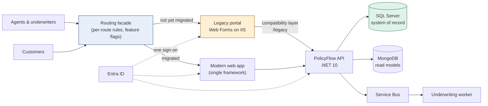
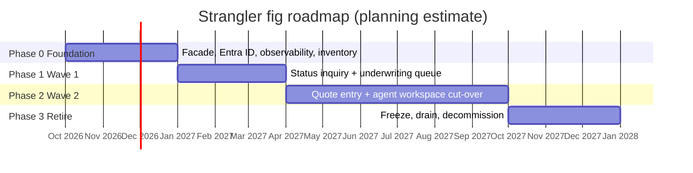

# PolicyFlow Modernization: Strangler Fig Plan

**Audience:** executive sponsors, product and technology leadership
**Purpose:** agree the approach, sequence, decision gates and risks for retiring the
legacy agent portal
**Status:** draft for review

> Timelines are planning estimates for a single stream-aligned team of 5–7 people.
> They are validated, and adjusted, at each decision gate rather than committed to
> up front.

---

## 1. Executive summary

**The problem.** Agents still work in a legacy ASP.NET Web Forms portal on .NET
Framework 4.8. Web Forms has no upgrade path to modern .NET. It runs only on
Windows/IIS, cannot be containerized, is not built or tested in our CI pipeline, and
every change to it is slow and risky. Customers already use a modern platform: a
.NET 10 API, a React web app, SQL Server, MongoDB and Azure Service Bus.

**The approach.** Replace the legacy portal **one capability at a time** while it
stays in service — the *strangler fig* pattern. A routing layer in front of both
systems sends each screen to either the old or the new implementation. Traffic moves
over gradually, backed by measurement, and any step can be rolled back in minutes.
When the old portal carries no meaningful traffic, it is switched off.

**Why this approach.** It is the only option that keeps the business running,
delivers value every quarter, and never bets the company on a single cut-over date.

**Where we start from — a strong position.** The hardest part is already done:

- **No business rule lives in the legacy portal.** Pricing, eligibility and
  underwriting all run in the modern API. The legacy pages only display and submit.
- **Both channels already share one system of record.** A quote entered in either
  portal is the same record, priced by the same code. Automated tests fail the
  build if the two channels ever price differently.
- **Legacy traffic is already measurable.** Every quote records which channel it
  came from, so retirement decisions can be made on data.
- **The newest legacy screen is already modern.** The underwriter work queue is an
  Angular module inside the old portal, calling the modern API. It moves to the new
  platform without a rewrite.

**The plan in one line.** Four phases over an estimated **12–18 months**: build the
routing and identity foundation, move the read-only and underwriting screens, move
quote entry and remaining agent workflows, then retire the legacy portal.

**Decisions needed now** (detail in §11):

1. Approve the phased plan and its decision gates.
2. Choose **one** front-end framework for the end state.
3. Approve Microsoft Entra ID as the single sign-on for agents and underwriters.
4. Set the retirement criteria and a legacy feature freeze.

---

## 2. Where we are today

| Area | Legacy portal | Modern platform | Implication |
|---|---|---|---|
| Technology | Web Forms, .NET Framework 4.8, IIS on Windows | .NET 10 API, React SPA, containers | Legacy cannot be upgraded, only replaced |
| Business rules | **None** — calls the API through a compatibility layer | All rules, in one domain layer | No rules to migrate; **screens only** |
| Data | No database of its own; uses the API | SQL Server (record), MongoDB (read models), Service Bus | **No data migration project** |
| Quote entry / status | ✅ Web Forms pages | ✅ Customer and agent pages | Duplicate screens today; one must go |
| Underwriting queue | ✅ Angular module hosted in Web Forms | ✅ React page | Built both ways; framework decision pending |
| Binding and payment | ❌ | ✅ | Already modern-only |
| Identity | None (open application) | Token-based, designed for Entra ID; enforcement off in demo | Must be solved **before** traffic moves |
| Build and test | Excluded from CI (Windows-only) | Full CI: build, tests, containers | Legacy regressions found late |
| Observability | IIS logs | Structured logs with end-to-end correlation IDs | Legacy blind spots |

**A lesson already learned.** When the legacy portal was first run end to end, two
existing pages failed on load — a defect that compiled cleanly and passed every
build check. Legacy changes need *runtime* checks, not just builds. That is built
into Phase 0.

---

## 3. Options considered

| Option | Description | Risk | Time to first value | Verdict |
|---|---|---|---|---|
| **Big-bang rewrite** | Build the full replacement, cut over on one date | **High** — one irreversible event; years of undocumented behaviour must be right on day one | 12+ months | ❌ Rejected |
| **Lift and shift** | Move Web Forms to cloud VMs unchanged | Low short-term, **high long-term** — keeps the dead-end technology and its cost | 2–3 months, little value | ❌ Rejected |
| **Upgrade in place** | Port Web Forms to modern .NET | Not possible — Web Forms does not exist on modern .NET | — | ❌ Not viable |
| **Strangler fig** | Replace capability by capability behind a routing layer | **Low** — every step small, measured and reversible | First wave in ~3–6 months | ✅ **Recommended** |

---

## 4. Guiding principles

These rules are what keep risk *and* rework low. Each maps to a failure pattern that
sinks modernization programs.

1. **Every business rule exists once.** Rules live in the modern domain layer.
   Neither UI holds one. *Prevents: two channels pricing the same customer
   differently.* (Already enforced by automated parity tests.)
2. **No new feature is built in Web Forms.** New capability ships on the modern
   platform, or as a modern module inside the old shell when agents need it before
   the shell is retired. *Prevents: investing in code scheduled for deletion.*
3. **Routing before rewriting.** Put the routing layer in first. Every later move
   becomes a configuration change with a rollback, not a deployment.
4. **Contracts before screens.** Build and test the API a screen needs before
   building the screen. The API outlives every UI.
5. **Retire by evidence, not by date.** A legacy screen is switched off when the
   metrics say so (§9), not when the plan says so.
6. **Every step reversible in minutes.** No change moves traffic without a tested
   way to move it back.
7. **Don't migrate what we will delete.** No time is spent improving, re-skinning or
   re-platforming the legacy portal.
8. **One target framework.** Two front-end frameworks in the end state is permanent
   rework: two skill sets, two component libraries, two test stacks.

---

## 5. Target architecture

### During the transition

### End state

The routing facade sends everything to the modern web app. The legacy portal, its
IIS servers and the `/legacy` compatibility layer are deleted together. The API,
data stores and worker are unchanged — **nothing below the UI is rebuilt at any
point in this plan.**

### The routing facade

The single most important investment. It is a reverse proxy — Azure Front Door
rules, or a lightweight .NET reverse proxy (YARP) in front of IIS if the portal
stays on-premises — that decides, per URL, which system answers.

| Capability | Why it matters |
|---|---|
| **Per-route routing** | `/QuoteStatus.aspx` can move while `/QuoteEntry.aspx` stays |
| **Cohort routing** | Send a pilot branch, or 10% of agents, to the new screen first |
| **Instant rollback** | A routing change, not a redeployment — minutes, not hours |
| **One URL for users** | Bookmarks and training material keep working through the transition |
| **Consistent security** | Security headers, TLS and rate limits applied once, in front of both |

---

## 6. Capability map and sequencing

Capabilities are sequenced by **risk** (lowest first) and **value**, so early waves
build confidence and the riskiest move happens with the most experience.

| Capability | Today | Target | Risk | Value | Wave |
|---|---|---|---|---|---|
| Quote status inquiry | Web Forms (full-page refresh every 2s) | Modern status page | **Low** — read-only | Medium | **1** |
| Underwriting work queue | Angular module in legacy shell | Modern web app | **Low** — already modern code | High | **1** |
| Agent "my quotes" list | Modern only | Modern | — | High | **1** (adoption) |
| Quote entry | Web Forms form | Modern agent workspace | **Medium** — highest daily volume | High | **2** |
| Home / navigation | Web Forms master page | Modern shell | Low | Low | **2** |
| Bind and payment | Modern only | Modern | — | High | Already done |
| Remaining legacy pages found in inventory | Unknown | Modern or retired | **Unknown** | Unknown | **Phase 0 inventory decides** |

**Why this order.** Wave 1 moves read-only and already-modern screens, where a defect
cannot corrupt data, to prove the facade, sign-on and rollback in production. Wave 2
moves quote entry, the highest-traffic write path, only after those mechanisms have
been exercised for real.

---

## 7. Roadmap

### Phase 0 — Foundation (months 0–3)

*Build what makes every later step safe. No user-visible change.*

| Deliverable | Outcome |
|---|---|
| **Behaviour inventory** of every legacy page, including undocumented workarounds agents rely on | No surprises in later waves |
| **Routing facade** in front of legacy and modern, initially routing 100% to legacy | Every later move is a config change |
| **Entra ID sign-on** for agents and underwriters; API authorization enforced | Identity solved before traffic moves |
| **Framework decision** (see §11) | No rework on the UI |
| **Legacy runtime smoke tests** in CI on a Windows agent | Legacy regressions caught before users |
| **Unified dashboards**: traffic by channel, errors, response times | Retirement decisions based on data |
| **Legacy feature freeze** announced | Stops new investment in the old portal |

**Exit gate G0:** facade live with a rollback rehearsed; sign-on live; dashboards
showing per-channel traffic; inventory signed off by the agent operations lead.

### Phase 1 — Wave 1: low-risk screens (months 3–6)

| Deliverable | Outcome |
|---|---|
| Quote status inquiry served by the modern app | First retired legacy page |
| Underwriting queue moved fully to the modern app | Legacy shell no longer hosts it |
| Pilot cohort (one branch) → then all agents, via facade | Real-world validation, reversible |
| Agent training and in-app guidance | Adoption, not just availability |

**Exit gate G1:** retirement criteria (§9) met for both screens; zero severity-1/2
incidents attributable to the move; support ticket volume at or below baseline.

### Phase 2 — Wave 2: quote entry and agent workflows (months 6–12)

| Deliverable | Outcome |
|---|---|
| Agent workspace becomes the default quote entry | Highest-volume path modernized |
| Cohort rollout: 10% → 50% → 100% of agents, each held for two weeks | Controlled exposure |
| Home and navigation in the modern shell | Agents stop entering the legacy portal |
| Any remaining pages from the inventory moved or explicitly retired | Nothing left behind |

**Exit gate G2:** legacy quote submissions below 5% of total for 30 consecutive days;
parity tests green; agent satisfaction at or above baseline.

### Phase 3 — Retire (months 12–15, buffer to 18)

| Deliverable | Outcome |
|---|---|
| Facade routes 100% to modern; legacy kept warm for 30 days as rollback | Safe final step |
| Legacy portal, IIS servers and `/legacy` compatibility layer decommissioned | Cost and risk removed |
| Web Forms project, Windows CI agent and legacy docs archived | Codebase simplified |
| Post-program review | Lessons captured |

**Exit gate G3:** zero legacy traffic for 30 days; decommission approved by business
owner, security and operations.

---

## 8. Data strategy

**There is no data migration in this plan.** That is the single biggest risk
reduction, and it is already in place.

- **One system of record.** The legacy portal no longer has its own database; both
  portals read and write the same SQL Server records through the API.
- **No dual writes, ever.** Two systems writing the same data independently is the
  most common cause of silent corruption during migrations. It cannot happen here
  because only the API writes.
- **Historical records stay where they are.** Quotes entered through the legacy
  portal are already modern records, tagged with their channel.
- **Downstream consumers** subscribe to events on Service Bus rather than reading the
  legacy system, so retiring it breaks no integrations.

If the Phase 0 inventory finds a legacy page backed by its own data (reports,
admin tables), that page is treated as a separate, explicitly scoped migration with
its own gate — not absorbed silently into a wave.

---

## 9. Governance and measurement

### Retirement criteria for any legacy screen

A legacy screen is switched off only when **all** are true:

| Criterion | Threshold |
|---|---|
| Traffic share on the legacy screen | Below 5% for 30 consecutive days |
| Production incidents from the modern replacement | No severity-1/2 for 60 days |
| Pricing and eligibility parity tests | Green on every build |
| Performance | Modern p95 response time at or better than legacy |
| Support | Ticket volume at or below pre-migration baseline |
| Business sign-off | Agent operations lead approves |

### Program KPIs (reported monthly)

| KPI | Why |
|---|---|
| % of agent transactions on the modern platform | Primary progress measure |
| Legacy pages remaining | Scope burn-down |
| Rollbacks performed and time to roll back | Proves the safety net works |
| Change failure rate and lead time (modern vs legacy) | Shows the delivery benefit |
| Legacy run cost (servers, licences, support hours) | Shows the financial benefit |

### Decision gates

Each phase ends at a gate (G0–G3) reviewed by the steering group: sponsor, product
owner, engineering lead, security, and agent operations. A gate can **proceed**,
**hold** (fix and re-review), or **roll back**. Gates are the mechanism that keeps the
timeline honest.

---

## 10. Risks and mitigations

| # | Risk | Likelihood | Impact | Mitigation |
|---|---|---|---|---|
| R1 | Undocumented legacy behaviour is missed and agents lose a workaround | Medium | High | Phase 0 behaviour inventory with agents; pilot cohorts; facade rollback |
| R2 | Agents resist the change | Medium | Medium | Pilot branch champions; training before each wave; same URLs via facade |
| R3 | "Temporary" compatibility layer becomes permanent | Medium | Medium | Retirement criteria and a scheduled decommission gate; feature freeze |
| R4 | Scope creep — "while we're here" redesigns | High | Medium | Parity first, improvements after cut-over; product owner owns the backlog |
| R5 | Identity and authorization gaps exposed when enforcement is switched on | Medium | High | Entra ID and enforcement in Phase 0, before any traffic moves |
| R6 | Two front-end frameworks persist | Medium | Medium | Framework decision at G0; one target platform |
| R7 | Legacy regressions during the transition | Medium | Medium | Runtime smoke tests on a Windows CI agent; legacy feature freeze |
| R8 | Key-person dependency on legacy knowledge | Medium | High | Inventory and characterization tests capture behaviour as executable checks |
| R9 | Program stalls after the "easy" waves | Medium | High | Gate reviews, KPI reporting, and an agreed legacy decommission date target |
| R10 | Cloud cost growth during parallel running | Low | Low | Parallel running limited per wave; legacy infrastructure retired at G3 |

---

## 11. Decisions needed from leadership

| # | Decision | Recommendation | Needed by |
|---|---|---|---|
| D1 | Approve the strangler fig approach, phases and gates | Approve | Now |
| D2 | **One front-end framework** for the end state | Standardize on the framework the organization already hires and supports. The work queue exists in both Angular and React today; whichever is not chosen is retired, not maintained. | G0 |
| D3 | Entra ID as the single sign-on for internal users | Approve | Start of Phase 0 |
| D4 | Legacy feature freeze (fixes only) | Effective at G0 | G0 |
| D5 | Retirement criteria in §9 | Approve as written, or adjust thresholds | G0 |
| D6 | Dedicated team of 5–7 for the program duration | Approve | Now |

---

## 12. What we will not do

- **No big-bang cut-over date.** Retirement happens per screen, by evidence.
- **No enhancements to Web Forms.** Fixes only, from G0.
- **No data migration project.** Not needed; the data is already modern.
- **No re-platforming of the legacy portal** to cloud VMs or containers.
- **No redesign during migration.** Match behaviour first; improve after cut-over.
- **No second UI framework in the end state.**

---

## Appendix A — How this repository demonstrates the plan

| Plan element | Where to see it |
|---|---|
| Business rules exist once; parity tests | `LegacyApiTests.LegacyAndModernSubmissions_ProduceIdenticalPricing` |
| Compatibility layer with no logic | `LegacyController`, `LegacyQuoteAdapter` |
| Channel tracking for retirement decisions | `Quote.Channel` (`Modern` / `LegacyWebForms`) |
| New feature as a modern module inside the old shell | `Underwriting.aspx` hosting the Angular module |
| The same screen on the target platform | React `/underwriting` and `/agent` pages |
| One system of record, event-driven processing | SQL Server via the API; Service Bus and worker |
| Identity from tokens, never request bodies | `SubmittedBy`, `ReviewedBy`; `docs/SECURITY.md` |
| Runtime-only legacy defect found by running it | `docs/PROGRESS.md`, Phase 13 |
| Technical detail of the seam | `docs/LEGACY-MODERNIZATION.md` |
